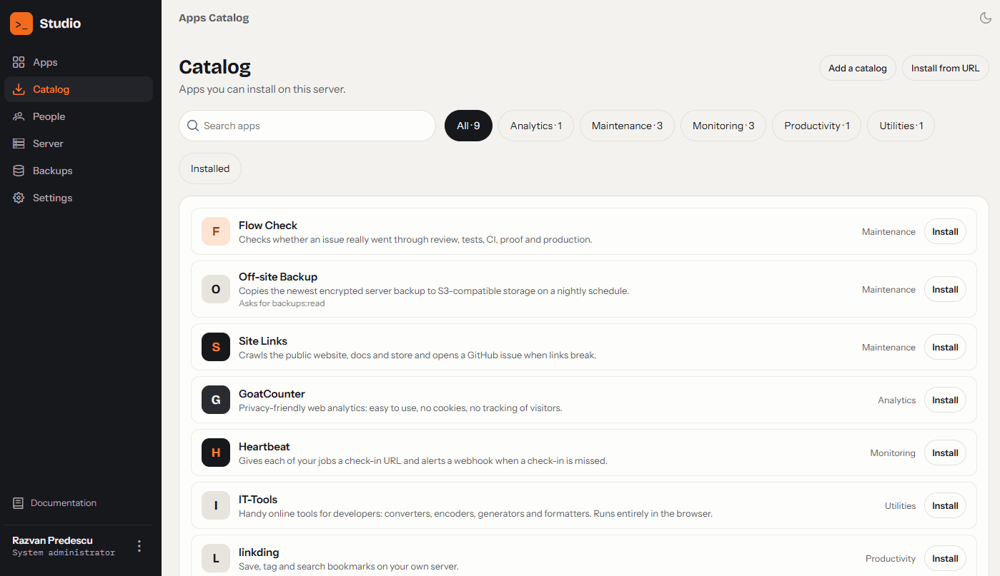
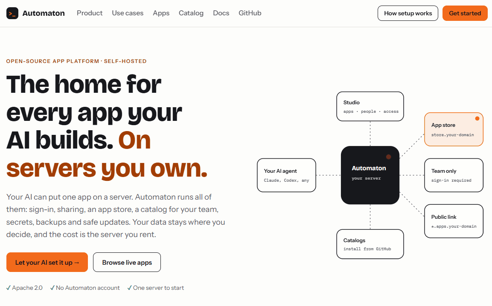

<div align="center">


# Automaton

**The home for every app your AI builds. On servers you own.**

[](LICENSE)
[](https://github.com/rzvdaniel/automaton/releases)
[](https://github.com/rzvdaniel/automaton/actions/workflows/tests.yml)
[](https://www.nuget.org/packages/Automaton.Cli)

[Website](https://automaton.monster) · [Docs](https://automaton.monster/docs/) · [Live apps](https://store.automaton.monster) · [Catalog](https://automaton.monster/catalog)



</div>

Your AI can put one app on a server. **Automaton runs all of them**: sign-in, sharing, an app store, a catalog for your team, secrets, backups and safe updates. Your data stays where you decide, and the cost is the server you rent.

## Why Automaton

- **Built for AI agents.** Your agent installs the server and builds, deploys and publishes apps, in your name and with your approval.
- **Private by default.** Nothing is public until you share it, with your team or with everyone.
- **HTTPS out of the box.** Every app gets its own address, with Let's Encrypt certificates requested and renewed for you.
- **A catalog of ready apps.** Analytics, monitoring, bookmarks and backups, installed in one click, or install any app straight from a GitHub repository.
- **Runs any stack.** An app is any language or framework that runs in a container, described in one `automaton.json`.
- **No lock-in.** Your server, your data, your domain. Open source under Apache 2.0.

## Get started

**With your AI agent.** Give it a Linux server, a domain and an email, and point it to [Install with your AI agent](https://automaton.monster/docs/install-with-ai). It installs Automaton and hands you a one-time link to choose your password.

**By hand.** Point `your-domain.com` and `*.your-domain.com` to the server (DNS only), open ports 80, 443 and 5671, then:

```bash
curl -fL https://raw.githubusercontent.com/rzvdaniel/automaton/main/scripts/install-automaton.sh -o install-automaton.sh
sudo bash install-automaton.sh --domain your-domain.com --email you@your-domain.com
```

Then [create the administrator](https://automaton.monster/docs/first-admin), [add a Runner](https://automaton.monster/docs/deploy-runner) and [deploy your first app](https://automaton.monster/docs/getting-started).

In our tests, the installer finished in about 2 minutes, and an AI agent went from an empty server to a live app in about 6 ([measurements](https://github.com/rzvdaniel/automaton/issues/561)).

<div align="center">

</div>

## Is it for you?

It fits if you build many small apps, tools or automations, often with an AI agent, and want them on servers you control. It does not fit if you need autoscaling, multi-region failover or a hosted service to sign up for.

> **Early access.** Automaton runs our own production server and is ready to use, but it is still growing. Read the [limitations](https://automaton.monster/docs/limitations) and [Is Automaton for you?](https://automaton.monster/docs/is-automaton-for-you) before you rely on it.

## For AI agents

Start with [llms.txt](https://automaton.monster/llms.txt). In an app folder, read the generated `AGENTS.md` and `automaton.json` ([reference](https://automaton.monster/docs/automaton-json)). Working on this repository: read [AGENTS.md](AGENTS.md).

## Contributing

Issues and pull requests are welcome. See [CONTRIBUTING.md](CONTRIBUTING.md), and report security problems as [SECURITY.md](SECURITY.md) describes.

## License

[Apache 2.0](LICENSE)
