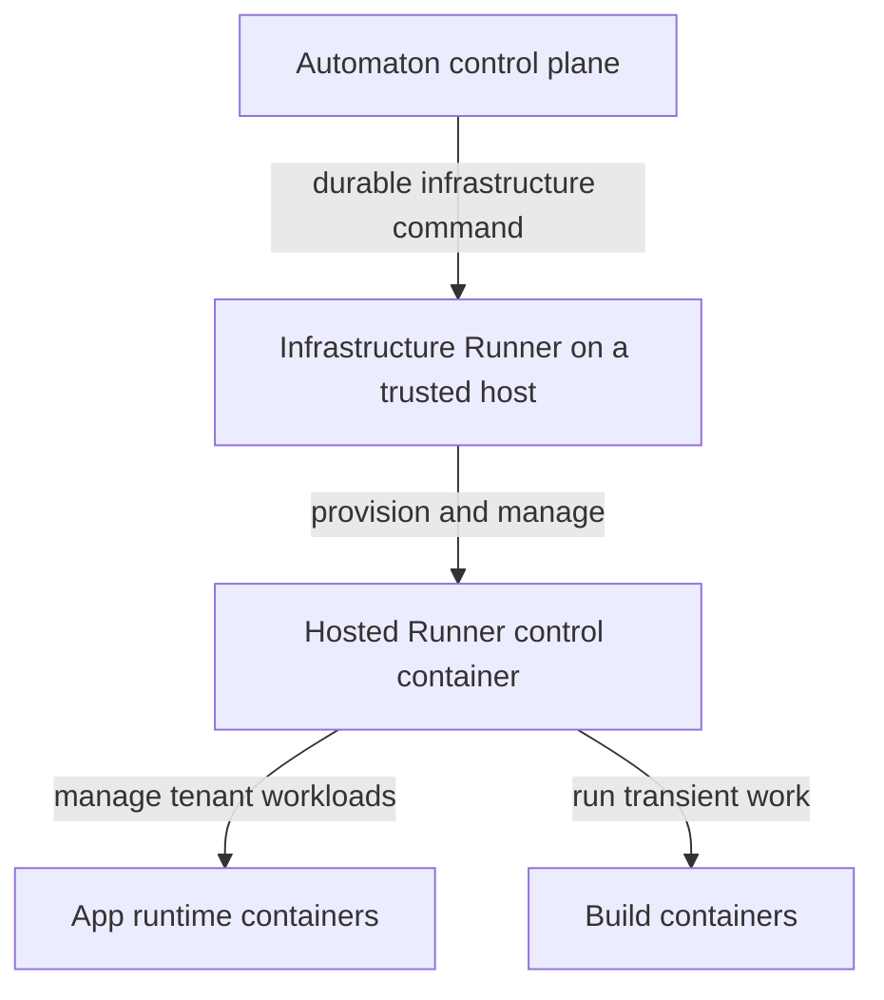
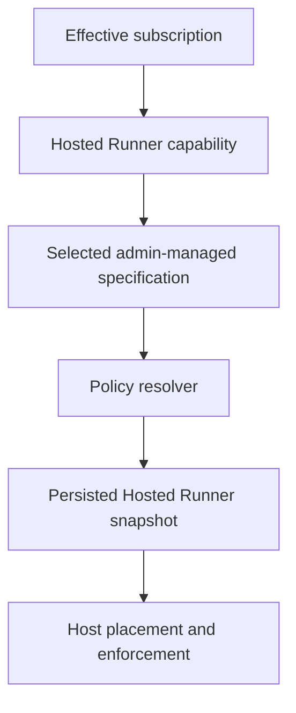

# Hosted Runner Infrastructure and Subscription Resource Plan

**Status (23 September 2026):** The host execution foundation has been demonstrated on a real host. The subscription resource audit, centralized policy resolution, and account storage identity through Stage 3 are implemented. Independent plan-owned budgets, complete account admission rules, and an aggregate account-wide writable-disk limit remain future work.

This plan records the operational model and the subscription-to-enforcement work discussed after the Stage 1D host validation. For detailed code paths and current gaps, see the [subscription resource policy audit](subscription-resource-policy-audit.md). The broader build and runtime hardening program is tracked separately in the [runtime resource isolation roadmap](automaton-runtime-resource-isolation-roadmap.md); its stage numbers refer to a different workstream.

## Operational model

1. An operator bootstraps the machine once with the Infrastructure Runner installation and enrollment scripts. The enrolled Infrastructure Runner is the trusted executor for host-level operations.
2. When an account needs a Hosted Runner, the control plane resolves the account's effective subscription and requested resource snapshot, selects an eligible host, and sends the infrastructure provisioning request.
3. The Infrastructure Runner creates or reprovisions the Hosted Runner container, its system and user volumes, its XFS project quota on the host filesystem, and its aggregate CPU, memory, and PID cgroup boundary.
4. The Hosted Runner manages the account's app runtime and build containers. Those workloads share its cgroup boundary; account data and brokered build workspaces under its user volume are charged to its XFS project on that filesystem.

The Infrastructure Runner and its operator-owned host storage remain outside the tenant boundary. Untrusted app and build requests must not set host paths, cgroup paths, XFS project IDs, Docker arguments, or quota commands.

## Reliability claim

Stage 1D validated the host execution mechanism on a real host: provisioning and reprovisioning established the expected compute and storage boundaries, over-quota writes were rejected, and storage measurement and control worked end to end. This is a foundation reliable enough to build on. It is not a claim that every app build, deployment, cleanup, abuse, scheduling, recovery, or observability path is production-complete.

## Current subscription-to-enforcement path

| Concern | Current behavior | Remaining decision or gap |
| --- | --- | --- |
| Eligibility | The effective plan's Hosted Runner capability selects an active specification. Resolution fails for missing, disabled, or invalid configuration. | Define any additional entitlement and admission semantics explicitly. |
| CPU, memory, disk, and PIDs | The centralized resolver obtains values from the selected admin-managed specification. Provisioning persists a snapshot; the Worker and Infrastructure Runner apply the corresponding cgroup and XFS settings. | A separately stored subscription-owned resource budget does not yet exist. Decide how it bounds specification choices without replacing operator-edited values silently. |
| Maximum applications | The selected specification supplies `MaximumApps`; assignment checks it per Hosted Runner. | Decide whether the product limit is per account or per Hosted Runner before changing admission. |
| Maximum Hosted Runners | The effective policy describes one normal runner per account, and provisioning normally reuses an existing runner. | Add an explicit account-level admission constraint if one is a hard entitlement; concurrent creation is not guaranteed by a database uniqueness rule. |
| Disk identity | `AccountStorageAllocation`, keyed by `ApplicationUser.Id`, owns a stable `StorageProjectId`. Hosted Runners carry a compatibility copy. | The same ID on different hosts or filesystems does not combine their usage into one quota. Other writable paths also remain outside the project. |
| Scheduling | Host selection checks eligibility and capacity using runner resource requests. Co-located same-account runners with conflicting disk snapshots are rejected; host actions also refuse to overwrite a shared project quota. | Placement capacity is not an aggregate account usage counter. Improve failure recovery and explainability as the policy matures. |

The previously discussed Free shape of approximately **0.5 CPU, 768 MiB memory, and 2 GiB disk** is product intent, not proof of current live settings. The resource model's code defaults are **0.5 CPU, 384 MiB memory, 512 MiB disk, 256 PIDs, and 3 applications**; existing administrator-edited specifications can differ. Inspect the persisted Free specification before stating or changing production values. The desired application count, particularly for static apps, still needs an explicit policy decision.

## Completed subscription resource stages

### Stage 1 — Trace and audit the resource path

**Complete.** The audit followed effective subscription → capability → specification → snapshot → host scheduling → Worker payload → host enforcement. It identified which limits are plan-selected, which are specification-derived, and which storage paths escape the current XFS project. See the [detailed audit](subscription-resource-policy-audit.md).

### Stage 2 — Centralize effective policy resolution

**Complete.** `SubscriptionResourcePolicyResolver` supplies CPU, memory, disk, tasks/PIDs, maximum Hosted Runners, and maximum applications through one control-plane resolution contract. Values still come from the selected administrator-managed specification. Normal provisioning does not accept client-provided resource limits. This stage did not add an independent plan budget or change product values.

### Stage 3 — Give the account a durable storage identity

**Complete in [PR #300](https://github.com/rzvdaniel/automaton/pull/300).** `AccountStorageAllocation` owns one stable positive XFS project ID per account. The migration adopts one unambiguous historical Hosted Runner ID and fails on conflicts; provisioning and reprovisioning reuse the allocation, and runner deletion does not release it. `HostedRunner.StorageProjectId` remains a synchronized compatibility snapshot for the existing Worker and reconciliation contracts.

Multiple Hosted Runners for an account may carry the same project ID. Placement and Infrastructure Runner guards prevent conflicting disk-limit snapshots from overwriting a shared XFS quota on the same host filesystem. User hard deletion is blocked while the allocation exists; no storage teardown action has yet been designed. Stage 3 did not add a global quota counter, migrate other writable paths, or change the app/build container storage contract.

## Policy target and scope

The Free policy discussed for this work is a product target, not a statement of current effective settings:

| Resource | Proposed Free target | Current qualification |
| --- | ---: | --- |
| CPU | 0.5 core | Current effective value is resolved from the selected administrator-managed Hosted Runner specification. |
| Memory | 768 MiB | Current seed default is 384 MiB; operator-edited specifications may differ. |
| Writable disk | 2048 MiB aggregate | Current seed default is 512 MiB. A shared XFS project ID alone does not aggregate usage across hosts/filesystems or paths that have not been assigned to it. |
| Tasks/PIDs | 128 | Current seed default is 256. |
| Max applications | Preserve existing Free behavior pending a product decision | Current specification default is 3 and enforcement is per Hosted Runner. |
| Max Hosted Runners | 1 in the normal reuse model | This is not currently a serialized account admission/uniqueness guarantee. |

The aggregate disk objective covers Hosted Runner system and user storage, app persistent data and volumes, build workspaces and retained caches, and any disk-backed temporary workspace. Infrastructure Runner storage remains infrastructure-owned and outside the account quota. `/tmp` should become explicitly bounded tmpfs. No stage should claim account-wide aggregate enforcement until usage across the relevant hosts/filesystems is actually within one verified enforcement domain or an equivalent trusted aggregate mechanism exists.

## Implementation and maintainability constraints

- Keep each stage as a focused branch and PR based on canonical `main`; review and validate it before starting the next stage.
- Use small cohesive domain/application services and value types where they clarify ownership or policy. Keep orchestration methods short; separate policy resolution, path discovery, storage preparation, quota assignment, and postcondition verification instead of growing one provisioning method with branches.
- Keep cyclomatic complexity low by giving each class one clear responsibility and extracting decisions into named operations. Avoid generic billing frameworks, speculative abstractions, and broad refactors unrelated to the stage.
- Put tests at the seams introduced by each stage. Preserve idempotency, retry safety, existing reprovision snapshots, and fail-closed behavior where enforcement cannot be verified.
- Recheck the live code and host/storage topology at the start of every stage. This roadmap is the intended sequence, not evidence that a future stage is already implemented.

## Full staged prompts and status

The detailed implementation prompts are preserved verbatim in the [subscription resource policy stage plan](subscription-resource-policy-stages.md). Use that document as the source for each stage's objective, implementation requirements, acceptance tests, validation, and final report.

Current progress: Stages 1–3 are complete. Stage 4 is next; Stages 5–10 remain planned. The prompts describe intended future work and do not claim that those stages are current enforcement.

The end-to-end “Free is one aggregate 2 GiB account disk limit” claim is valid only after all account-owned writable paths are covered and the enforcement domain accounts for their actual placement. Reusing a numeric XFS project ID across different hosts or filesystems does not create a global aggregate quota.
