# Managed Platform M0: Resource and Storage Acceptance Inventory

This document records the M0 baseline and decisions for the managed-platform completion plan. The writable-path table below is the M0 snapshot; the M1 implementation update records current changes and remaining gaps. This is not a claim that aggregate account storage enforcement is complete.

## Current resource flow

```mermaid
flowchart LR
    Account[Account and effective subscription] --> Capability[HostedRunner capability]
    Capability --> SpecId[HostedRunner SpecificationId]
    SpecId --> Spec[Active administrator-managed Hosted Runner specification]
    Spec --> Resolver[SubscriptionResourcePolicyResolver]
    Resolver --> Snapshot[HostedRunner desired or pending specification snapshot]
    Snapshot --> API[API provisioning preparation and host placement]
    API --> Event[ManagedRunnerProvisionRequestedEvent]
    Event --> Worker[Worker validates account storage locality and builds action payload]
    Worker --> Infra[Infrastructure Runner executes trusted provision/reprovision action]
    Infra --> Docker[Docker Hosted Runner container and XFS project quota]
    Docker --> Cgroup[Hosted Runner cgroup; app/build containers join its subtree]
```



The effective Hosted Runner resource values resolve from the user's effective subscription through its Hosted Runner capability and `SpecificationId` to the selected active specification. The specification is administrator-managed and its operator-edited values remain authoritative. The Free seed/model defaults are CPU `0.5`, memory `384 MiB`, disk `512 MiB`, PIDs `256`, and applications `3`; existing persisted specification values can differ. `MaxHostedRunners` is currently the policy constant `1`, reflecting normal reuse of one non-deleted Hosted Runner per account. It is not a database uniqueness constraint and does not add a separate admission path for administrative operations.

Provisioning copies effective resources into the existing Hosted Runner snapshot. Ordinary requests preserve a running snapshot; forced reprovision places current resolved policy in `PendingSpecificationSnapshot`, which the Worker prefers. Client provisioning requests do not supply authoritative resource overrides. Trusted administrator specification APIs remain the configuration path.

### Resource ownership table

| Resource | Current source of truth | Persisted where | Enforced where | Intended future source of truth |
| --- | --- | --- | --- | --- |
| Hosted Runner CPU | Effective subscription capability's active Hosted Runner specification; Free seed/model default `0.5` | Hosted Runner current/pending specification snapshot | Docker Hosted Runner CPU setting and Hosted Runner cgroup; app/build containers join that cgroup subtree | `SubscriptionResourcePolicy.CpuLimitCores` resolved from subscription policy |
| Hosted Runner memory | Same specification; Free default `384 MiB` (reservation default `256 MiB`) | Hosted Runner snapshot | Docker memory/reservation settings and cgroup | `SubscriptionResourcePolicy.MemoryLimitMb` |
| Hosted Runner disk | Same specification; Free default `512 MiB` | Hosted Runner snapshot and `StorageAllowanceBytes`; account storage allocation keeps the XFS project identity and locality | XFS project hard quota on the system and user named volumes, using the specification disk limit | `SubscriptionResourcePolicy.DiskLimitMb`, applied to all account writable storage domains in M1 |
| Tasks/PIDs | Same specification; Free default `256` | Hosted Runner snapshot | Docker `--pids-limit` on Hosted Runner; app/build process membership is within the Hosted Runner cgroup | `SubscriptionResourcePolicy.TasksLimit` |
| Hosted Runner count | Effective subscription policy currently supplies `MaxHostedRunners = 1` | Derived at provisioning time; count is persisted Hosted Runner rows | API serializable admission transaction, with the account row locked on MySQL; counts non-deleted rows and reuses the sole row, including Disabled rows | `SubscriptionResourcePolicy.MaxHostedRunners` |
| Applications per Hosted Runner | Specification `MaximumApps`; Free default `3` | Hosted Runner specification snapshot | `HostedRunnerAppCapacityService` locks the Hosted Runner on MySQL and counts assigned deployment targets before assignment | `SubscriptionResourcePolicy.MaxApplications`; current mapping preserves existing per-Hosted Runner semantics |
| Build concurrency | No account-level build concurrency resource was found. Per-target deployment gates and operation lifecycle prevent some duplicate work; Runner app actions have a process-local gate of `4` | Deployment operations/attempts and Runner process state | Current per-target/process mechanisms; no cross-account build allocation | A separately specified bounded capacity policy in M2; not an extra field in the minimal storage/resource contract |
| Scheduled Actions | Existing subscription `ScheduledActions` capability: enabled, maximum schedules, minimum interval, maximum concurrent executions, monthly execution limit | Plan capabilities, action schedules, and occurrences | API schedule validation and Worker occurrence/concurrency checks | Retain as its existing capability; do not fold into `SubscriptionResourcePolicy` |

The `MaximumApps` enforcement counts assigned deployment targets for the Hosted Runner, excluding the target being reassigned. This inventory preserves that existing meaning; it does not redefine the count as unique app IDs or account-wide application count.

## Storage project ownership and locality

`AccountStorageAllocation` owns the stable account XFS project ID. `HostedRunner.StorageProjectId` remains as a compatibility mirror consumed by existing provisioning and storage-measurement worker payloads; it is not the ownership authority. M0 adds nullable `StorageRunnerHostId` and `StorageFilesystemUuid` to the account allocation. Host identity is retained as a value, not a foreign key, so retiring a host does not erase locality. Provisioning adopts a unique historical host when possible, records a selected host before publishing work, and refuses ambiguous/mismatched history. Infrastructure action results and storage measurements establish and verify the filesystem UUID. No storage is moved and no historical project ID is rewritten by this change.

The `AddAccountStorageLocality` migration adds nullable columns without a destructive backfill. Existing rows are adopted lazily when provisioning or authoritative storage verification provides evidence. For safe adoption, preserve the existing project ID, infer a host only when all relevant Hosted Runner history agrees, obtain the filesystem UUID from the trusted host action, and block accounts with unknown or multiple storage locations for operator review. Never choose a new host or project ID as an implicit repair. Any physical move requires an explicit later storage-migration operation with copy, verification, and rollback procedures.

## Tenant and platform writable paths

| Path/category | Current location and write path | Current quota/retention boundary | M0 ownership decision / remaining gap |
| --- | --- | --- | --- |
| Hosted Runner system storage | Docker named volume mounted at `/automaton/system` | Same XFS project ID and hard limit as the account user volume | Account Hosted Runner storage; retained across reprovision, removed only according to Hosted Runner deletion disposition |
| Hosted Runner user storage | Docker named volume mounted at `/automaton/storage`; workspace defaults to `/automaton/storage/workspace` | Same XFS project quota as system storage | Account storage; workspace, app data, and artifacts share the same quota domain |
| App source/workspace and deployment staging | Runner workspace app/target paths under the user volume; deployment package transfer initially uses the Runner's `Path.GetTempPath()/uploads/<session>` | Final workspace data is XFS-accounted; transient upload staging is in the Runner container writable layer, outside the project quota | App/build-owned durable workspace; temporary transfer files need bounded scratch and cleanup policy in M1 |
| API request upload buffering | App file endpoints accept request bodies up to `200 MiB`; ASP.NET multipart buffering can spill request data into the API host temporary directory before the API relays or stores it | API host temporary storage, outside account XFS project quota; per-request size is bounded, but aggregate account/host admission and cleanup are not part of Hosted Runner quota | Platform ingress overhead; bound concurrent ingress/temporary usage and retention separately |
| Accepted deployment packages | API stores each package under `AppData/deployment-operations/<operation>.zip` until its deployment operation reaches a terminal state | Each package is limited to 50 MiB; the directory is capped at 1 GiB and 100 files per API process. Normal terminal operations delete packages; periodic reconciliation deletes unreferenced files older than 24 hours while preserving pending/running operations | Platform-owned durable staging; multiple API processes sharing one package directory do not coordinate package admission |
| Build source input | Hosted Runner build container mounts the deployment staging source subpath from the user volume at `/automaton/source` read-write | Source writes are within the user volume's XFS project; the build container's own writable overlay is outside it | Account storage for source; M1 must bound or deny overlay writes and set retention for failed/cancelled staging |
| Build cache | Runner has per-target workspace cache paths; Runner deployment cleanup removes the target cache, while the audited host-build container mounts only the source subpath | Runner-side cache files under workspace are within the user volume; build overlay/cache elsewhere is not XFS project-accounted | Build cache is disposable platform/app workspace data; no complete quota contract was found |
| Runtime artifacts and app frontend | Workspace artifacts are persisted in the user volume; the app container mounts the selected artifact at `/automaton/app` read-only | Artifact files on the user volume are quota-accounted; container writable overlay is not | Retain active/rollback artifact policy separately; overlay writes remain an escape path |
| App persistent data and declared storage mounts | Per-app `workspace/data/<app>` subpaths in the user volume, mounted read-write at `/automaton/data` and declared mount locations | XFS-accounted by the Hosted Runner's project quota; app data survives target cleanup | Account storage, with app-scoped ownership; deletion of target preserves app data, explicit app-data deletion removes it |
| Legacy/generic media and file writes | Runner media and persistent app data resolve beneath the user volume; generic container writes use explicit `/automaton/data` mounts | Explicit mounted data is quota-accounted; app container overlay is not | Account storage only for managed volume paths; no isolation for other container writable-root paths |
| Upload/result temporary files and `/tmp` | Runner uses `Path.GetTempPath()` for `/uploads` and `/results`; app/build/Hosted Runner containers also have writable root filesystems | No dedicated `/tmp` tmpfs or disk project mount; normally lands on container writable overlay and Docker host storage. Docker daemon/host settings can add external limits not configured by this application path | Scratch should be bounded memory-backed tmpfs, with tmpfs memory included in the Hosted Runner memory budget; no unlimited disk-backed escape |
| Docker writable root filesystems | Hosted Runner, generic app, and build containers do not set Docker `--read-only`; app/build containers can write to container overlay outside explicit mounts | Not covered by the account XFS named-volume project quota; consumes host Docker storage subject to host-level configuration | M1 must make roots read-only where supported and provide explicit bounded scratch/data mounts |
| Docker images, overlay metadata, and container logs | Stored under the Runner Host Docker data root; Hosted Runner container gets configured Docker local log size/count, but app/build invocations do not provide per-container log bounds | Shared host/platform overhead, outside the account project quota; app/build log behavior follows daemon defaults | Platform-owned overhead with host watermarks, image/log retention, and cleanup policy still to be specified |
| API app source/live/version files | `AppFileStorageService` writes under API `ContentRootPath/AppData/apps/<owner>/<app>` | Control-plane filesystem; not charged to account XFS quota; the audited writes have no subscription storage limit here | Platform/control-plane-owned copy; add separate bounded allocation/retention policy or move to a managed account storage path in a later focused milestone |
| Published frontend files | `PublishedAppStorageService` stages and copies into configured `PublishedApps.RootPath` (default `AppData/published-apps` under API content root); unpublish moves into `.disabled` | Control-plane filesystem; not charged to account XFS quota; disabled copies remain until separately cleaned | Published platform assets; require separate platform quota and retention/cleanup policy |
| App thumbnails and screenshots | `AppImageManagementService` writes to API `ContentRootPath/AppData/media/app-thumbnails|app-screenshots/<app>` | Control-plane filesystem; not charged to account XFS quota; thumbnail replacement deletes earlier thumbnails, while screenshots are limited to eight per app but have no byte quota here | Platform/control-plane media until a later explicit managed-account media path and quota is designed |
| Runner app-media uploads | `HubFileTransferService` writes `StorageScope.Media` files under the Runner workspace's app data/media path | Under the user volume and XFS-accounted; app data deletion removes its root | Account storage; inventory legacy transfer callers and cleanup policy in M1 |
| Infrastructure Runner workspace | Infrastructure Runner's host workspace is mounted into `/automaton/workspace` from its configured host path | Infrastructure-owned storage, outside account storage project/quota | Remains infrastructure-owned and must never be charged to tenant quota |

The current XFS quota covers the system and user named volumes only. Known escape paths are container writable overlays (`/tmp` included), control-plane app file and published-app storage, shared Docker image/overlay/log storage, and any transient or cache write not placed under the user volume. Infrastructure Runner storage is an intentional platform-owned exclusion.

## M1 implementation update

The M1 implementation adds these enforcement paths:

- Provision and reprovision apply one XFS project quota to both Hosted Runner named volumes. They now verify the project ID and project-inheritance flag on each volume root before replacing the container and again after the container starts. Storage measurement rejects a root whose project ID, inheritance flag, filesystem identity, or hard quota no longer matches the persisted account allocation and allowance. The opt-in Linux/XFS acceptance test also checks existing data, nested-file inheritance, combined writes, overflow, and preservation across reprovision.
- Hosted Runner temporary .NET files use `/automaton/storage/.tmp` through `TMPDIR`, so uploads, results, and temporary preparation files land in the user volume's XFS project. Direct `/tmp` is a 32 MiB tmpfs. The service still has a writable root filesystem because its startup installs app-declared system packages into the container image layer.
- Generic app runtime and build containers use a read-only root filesystem, a 32 MiB `/tmp` tmpfs, the specification-backed shared-memory limit, and specification-backed bounded Docker logs. App data remains on the writable user-volume mounts; build source and its home/cache directories remain under the user-volume staging path. Build containers are removed on completion/failure, and failed deployment staging is covered by cleanup tests.
- API relays for image resolution, builds, and app-container creation require fresh Runner Host storage telemetry and preserve the measured host reserve. Container inspection, log retrieval, and removal remain available during low-space recovery. This is an admission watermark, not a per-image cache quota; Docker image size and concurrent pulls can still consume available space after admission.
- App import and runtime ZIP upload validate expanded archive content before creating an imported app or applying `clean=true`. Each archive is limited to 200 MiB expanded and 10,000 entries. This bounds a single extraction request; it does not establish an account-wide quota or retention policy for API-side source, live files, snapshots, and published assets.
- Editable API source is limited to 200 MiB and 10,000 files per app across direct file writes, MCP writes, archive installs, and source copies used by clone/remix. Replacing a file counts only its final size, so repeated writes cannot bypass the cumulative source bound.
- API version snapshots stage under the version directory, validate the same 200 MiB / 10,000-file bound, and prune snapshot directories older than the newest ten after a successful snapshot. Older version metadata remains; only snapshot files outside the recent window are pruned. Cleanup failures are logged and may leave stale snapshots. The current app memory surface already uses the latest ten summaries, and no source-snapshot restore endpoint exists.
- Generic deployment package uploads are limited to 50 MiB at request/package storage, and their ZIP content is checked against the same 200 MiB expanded-size and 10,000-entry bounds before dispatch. API source extraction stages into a sibling directory and replaces the current source only after validation and extraction succeed; failure preserves the existing source and removes that attempt's staging directory.
- Accepted generic deployment packages are stored through unique `.uploading` files and atomically moved to their operation path only after a complete copy. The package directory rejects admission if the configured per-process 1 GiB or 100-file budget would be exceeded; rejected and failed copies do not replace or delete existing packages. Deployment-operation dispatch periodically reconciles unreferenced package files older than 24 hours, while retaining packages for pending and running operations.
- API runtime ZIP uploads keep the merged live output for each app within 200 MiB and 10,000 files. Uploads stage a clean replacement or merge, and commit only after every included file is written successfully; oversize or failed writes leave the prior live output in place. This bounds each app's generated/published source tree but does not combine the API copy with its Hosted Runner quota or bound all apps together.
- Public publish staging and final output are limited to 200 MiB and 10,000 files per app. A publish outside those bounds is rejected and its staging directory is removed; promotion restores the previous published folder if installing the staged folder fails. Aggregate published output across apps remains outside a shared quota.
- Multipart request bodies are admitted at most two at a time per API process before MVC form binding can spill bodies to host temporary storage. Combined with each endpoint's request-size limit, this bounds API-side concurrent multipart buffering per process; it does not form a shared quota across API replicas or constrain upstream proxy buffering.
- Unpublishing an app moves its public output out of the serving path and deletes matching `.disabled` copies, including stale copies left by earlier unpublish operations. The source/runtime package remains available for republishing.

The following writable categories remain outside the Hosted Runner account XFS project and need an explicit bounded platform-storage contract or a later storage migration: the Hosted Runner service writable root layer (including apt-installed packages), Docker image/cache data and metadata under the Runner Host data root, and aggregate live/published output across apps. API deployment-package admission and stale-file cleanup are bounded per process; multiple API processes sharing one package directory do not coordinate package admission. API thumbnails are limited to 2 MiB each and screenshots to eight per app on the control-plane filesystem; Runner app-media uploads also have a per-app quota. Legacy `.disabled` copies remain until that app is next unpublished. Host reserve admission reduces exhaustion risk for Docker image work but does not impose a maximum cache size or guarantee a large image pull will fit. Per-app limits do not create a shared account quota across all apps or cap Docker image/cache growth. API multipart temporary storage is bounded per API process by its configured concurrent multipart request limit and per-request endpoint limits, but upstream proxy buffering remains outside this control.

The real-XFS acceptance remains opt-in and must run on a Linux host whose Docker volume data root is XFS with project quotas enabled. A skipped test on a non-XFS development host is not evidence of hard-quota enforcement.

## M0 baseline: `/tmp` and root filesystem behavior

No dedicated bounded tmpfs is mounted at `/tmp` by the Hosted Runner, app, or build Docker commands audited for this inventory. The Hosted Runner has a configured bounded `/dev/shm` via `--shm-size`; this does not bound `/tmp`. Docker commands for app and build containers omit `--read-only`, so their root filesystems are writable overlay filesystems. Writes to explicit persistent app data mounts are XFS-accounted; writes to the rest of the root filesystem are not covered by the account XFS project quota.

## M0 admission and adoption state

- Hosted Runner admission uses the effective policy maximum and counts non-deleted records, including Disabled, Failed, Pending, and Provisioning states. Existing over-limit rows are preserved and the request fails with IDs for operator resolution; no automatic deletion/downgrade occurs.
- MySQL admission is serialized by a transaction and an `AspNetUsers` row lock before the count/reuse decision. Normal provisioning reuses the sole row. A separate relational multi-connection race test against production-equivalent MySQL remains useful evidence before relying on the lock behavior operationally; in-memory tests do not prove database locking.
- App assignment retains the existing per-Hosted Runner count and Hosted Runner row lock on MySQL. It is separate from Hosted Runner admission.
- Account storage allocation retains historical project IDs and conflicts explicitly when historical IDs disagree. Host/filesystem locality is backfilled only from unambiguous trusted evidence; ambiguous/unknown locations block provisioning for operator review.
- Scheduled Action plan capabilities remain independently validated and enforced; build concurrency and host-wide capacity reservation are not solved by M0.

## Minimal future policy contract

The target policy remains deliberately small and is future design until every consumer and enforcement path has migrated:

```csharp
public sealed record SubscriptionResourcePolicy(
    decimal CpuLimitCores,
    int MemoryLimitMb,
    int DiskLimitMb,
    int TasksLimit,
    int MaxHostedRunners,
    int MaxApplications);
```

The repository already has a resolver-backed policy value for Hosted Runner provisioning and maps `MaxApplications` to the existing specification `MaximumApps`. The complete account-wide source of truth still requires that `DiskLimitMb` cover every account-owned writable storage category through M1. This contract does not absorb schedule capabilities, billing, prices, organizations, or build concurrency.
