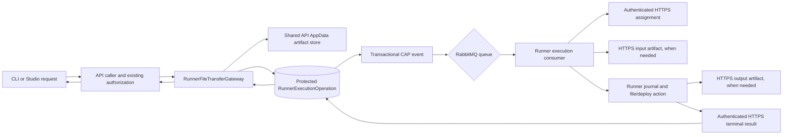

# Runner management transports

The [self-hosted roadmap](../roadmap/README.md) defines the supported Runner model. This guide describes the current Machine Management Runner transport; the retired Hosted, Standard, Privileged Host and Infrastructure profiles are not supported.

Updated: 28 October 2026.

The supported Runner is an enrolled Machine Management Runner. Its SignalR connection and HTTPS operations require the same persisted Runner API key; owner keys cannot impersonate a Runner. The former Admin Hosted/Infrastructure Runner screens, installers, and registration endpoints are retired. Bundled Infrastructure System Application Actions are no longer offered through Admin; new legacy system schedules are rejected, and the Worker skips retained platform schedules without deleting their history. A replacement system capability should be built as an ordinary administrator-owned App.

Slice 5 and the isolation corrections are released; automatic cutover recovery from PR #348 is live as `3d890c29`. Both retained Runners use protocol v5 and CI #4978 immutable digest `sha256:3a535215a024c31f5169ae4a83dde57ada072ee3f1c1401bd81a6cf7e12a5da8`. Published media, BYO tunnel responses, two-account denial/authentication toggles, and rapid rollback/rollforward with queued earlier targets passed in production. No manual tunnel reconciliation was used in the final round trips; durable validation completed and queues drained. RM is complete for the installed x64 cohort. See the [historical automatic recovery evidence](https://github.com/rzvdaniel/automaton/blob/57941d9971f58409356a74cbcf2529292c2f8a61/docs/roadmap/managed-platform-completion-plan.md#automatic-recovery-acceptance--2026-10-05). Cross-host package/artifact availability remains unverified.

## Durable operation path

The repository development edge also defines `api-live-edge`, matching the default tunnel-service name used by generated app routes. A missing service disables those routes even while API and container health checks pass.

### Account isolation and runtime policy

Action execution, result, and log reads authorize access to the App before loading execution data. The Action controller translates an inaccessible App or missing execution into HTTP 404 and an explicit permission denial into HTTP 403; unexpected exceptions retain the normal error handling. Runner assignment and artifact endpoints continue enforcing their bound Runner credentials separately.

Every authorized App update reconciles the existing runtime route configuration from committed database state, for eligible explicitly assigned Runner tunnel targets. Historical Hosted endpoint routes are no longer generated, and retained Hosted assignments are not adopted into tunnel routes. Reconciliation runs immediately after persistence, before app file storage and auditing. If route application fails, retrying the same saved authentication setting attempts reconciliation again; no change detection or process-local pending flag is required. A failed write leaves the previous route file intact; database persistence and route application are not one transaction, so a failed request still requires retry or startup reconciliation. Both enabling and disabling authentication take effect without redeployment.

The follow-up was reviewed, passed CI #4970 and released as `e888fef2`. Two-account Action reads/cancellation and authentication toggles passed on production Hosted and BYO routes without app redeployment; runtime container IDs stayed unchanged. The remaining automatic recovery gate passed after PR #348 release, as recorded above; that historical transport milestone is distinct from the current self-hosted roadmap and its deferred acceptance.

RabbitMQ messages contain only operation and Runner identities. The executable request is protected at rest by the existing API Data Protection service. API replicas that serve a given operation must share its existing key ring and, for artifacts, the existing package volume. Runner delivery is journaled: a saved result is returned on redelivery, so completed work does not run again after a lost callback or restart. Accepted work whose outcome cannot be known is terminalized as `Lost`, rather than repeated.

`RunnerExecutionOperationService` routes media stats/metadata to the separate management queue. File writes, downloads, uploads and deployment work use the execution queue. The Runner processes them through `RunnerExecutionProcessor` and `RunnerFileTransferExecutor`; completed results are applied through the same authenticated HTTPS result endpoint as other durable Runner operations.

## Runner reconnect and assignment

Runner removal is a two-stage, owner-confirmed host workflow. Preparation verifies that no app environments, project links or unfinished operations depend on the Runner, then persists `Runner.DeletionRequestedAtUtc`. Assignment persistence and durable operation admission lock the Runner row and reject a removal intent, so another API replica cannot admit new work after preparation commits. Preparation and final deletion recheck dependencies in serializable transactions. Studio provides an installation-scoped host command that refuses remaining app/Action containers, validates container and volume ownership, and removes the management container, shared static server, workspace volume and runtime network. The host configuration directory is retained. Final deletion requires explicit owner confirmation and an offline Runner, then revokes broker access and the installation API key. Host cleanup is attested by the owner, not independently verified by the API after uninstallation. Closing Studio leaves the durable removal intent available for retry.

App deletion uses `cleanup-target-resources` and `cleanup-app-resources` commands. The Runner unpublishes the Live static site before removing runtime and workspace state, preserving other sites and the shared static server. Additional-target cleanup leaves the Live static site alone; whole-app storage cleanup also unpublishes any retained site on that Runner. A static reload failure prevents workspace/data deletion. Dedicated container and Compose removal continue through `RunnerRuntimeContainerManager`; runtime cleanup failures preserve metadata for retry. Older Runners reject the new command kinds so they cannot acknowledge cleanup while silently ignoring static unpublication.

Apps with a durable deletion claim are excluded from Traefik configuration and runtime gateway authorization/forwarding. App deletion refreshes edge configuration before deleting app files and the database record, so a route-write failure preserves both for retry. Deleting the last routed app removes the generated route file; deleting a static site removes its Nginx location and published releases while preserving sibling sites. Proxy file watchers can apply changes asynchronously; the gateway's database check rejects a deleting/deleted app even while an older edge rule is still loaded.

Routing still generates per-app/environment Traefik rules and per-site Nginx locations. Updates regenerate the corresponding whole configuration, and concurrent route writers use a shared configuration file. This is not validation for thousands of apps or highly concurrent publishing. A separate scaling change should evaluate a fixed wildcard edge route with authoritative app/target lookup in the runtime gateway, and static serving with an active-release lookup that preserves the current allowlist and release isolation. Measure request latency, publication/deletion latency and concurrent updates before claiming that scale; retain authentication, immediate deletion denial and protection of unpublished releases.

Runner reconnect records authorized connection/session and installation reports without selecting a Runner for an unassigned app or rebinding deployment targets from Hosted Runner enrollment history. App placement remains owned by the explicit assignment API and its authorization/runtime reassignment guards. Previously assigned Machine Management targets continue through the durable operation path; retired profile records remain historical data and are not migrated.

## File-transfer operations

Fresh app deletion failure releases its claim and regenerates routes from durable state; interrupted-deletion recovery keeps its claim and routes revoked. Installation identity is immutable through Runner updates, and host uninstall verifies the management container's persisted Runner ID as well as its installation environment. The volume preflight inspects all managed Compose app data volumes and refuses current-machine or unattributed volumes, including volumes created before machine ownership labels existed. Clearly foreign volumes remain untouched. No legacy execution flow or automatic storage adoption is introduced.

Whole-app cleanup also discovers Docker Compose data volumes by app identity and verifies managed/resource labels, target identity and the deterministic volume name before removing them. Volumes are removed without force, after runtime cleanup and before app workspace/data deletion; a busy or unverified volume fails deletion and preserves remaining storage. Individual-environment cleanup retains persistent volumes. Newly created Compose data volumes carry the machine Runner identity so the host uninstall command can refuse retained app data rather than silently orphan it.

App/target cleanup commands use the execution queue, because container teardown can await typed Docker operations on the management queue. Routing cleanup itself to the single-consumer management queue would block those nested operations. Metadata reads and typed host-container operations keep their existing management routing.

| Operation | API caller | Queue | Runner behavior | Artifact direction |
| --- | --- | --- | --- | --- |
| App file upload | `AppFileUploadService` | Execution | Fetches bytes into the existing `Path.GetTempPath()/uploads/{session}` area | API store → Runner HTTPS GET |
| App file download | `AppFileDownloadService` | Execution | Reads the existing `Path.GetTempPath()/results/{session}` file | Runner HTTPS POST → API store → API response |
| Media upload | `AppMediaStorageService` | Execution | Writes into the app's existing data/media root | API store → Runner HTTPS GET |
| Media download | `AppMediaStorageService` | Execution | Reads the app media file after metadata lookup | Runner HTTPS POST → API store → API response |
| Media stats/metadata | `AppMediaStorageService` | Management | Reads current app media usage or file metadata | No artifact |
| App package deployment | `DeploymentPackageRunnerService` | Execution | Fetches the package and calls `RunnerDeploymentService` | API store → Runner HTTPS GET |

The former per-user Hosted Runner package-deployment queue and callback API have been removed. All supported app package deployments use the assigned Machine Management Runner's durable typed file-transfer operation described above.

## Authorization, bounds and storage

- App-facing API routes retain their existing authentication and app ownership checks. Before dispatch, `RunnerFileTransferGateway` verifies that the requested Runner remains assigned to a target owned by the requesting account.
- Artifact endpoints require the Runner API key and stable `X-Runner-Id`; the API authorizes that key against the persisted operation's Runner. Artifact reads/writes are refused for cancelled or terminal operations.
- Each transfer artifact is capped at 200 MiB. The existing `DeploymentPackageStore` capacity applies to the combined package and transfer files; defaults are 1 GiB and 100 files. Writes and expiry cleanup take the existing AppData lock file so API processes sharing that volume serialize capacity checks. No separate storage service or broker payload is introduced.
- Runner input requests pin their length and SHA-256 in the protected operation. Download results include the output length and SHA-256; the API checks both against the stored artifact before accepting a successful result.
- Inputs are deleted after a terminal result. Download outputs are deleted under the shared AppData storage lock after the API receives the persisted terminal result and finishes streaming them, so ordinary media reads do not accumulate files; abandoned outputs remain covered by expiry cleanup. Incomplete operations retain required inputs and outputs so retry/recovery can proceed.
- Each app-file download HTTP attempt gets a fresh operation ID, while the requested file session remains in the command. A prior `404`, or a successful operation whose output was later cleaned up, cannot poison a later retry using the same session.
- Blue/green API slots on the same host share `AppData/deployment-operations`. Availability when slots run on different hosts is **not established**. Do not treat same-host slot acceptance as proof of cross-host storage.

Hosted Runner storage reporting, verification and enforcement are retired. The Hosted telemetry and Admin verification endpoints, trusted measurement Action, Worker verification dispatch and account-locality adoption are removed. Direct execution and API callbacks reject the retired Actions; addressed retired queue deliveries use terminal acknowledgement without invoking an executor. At startup, the Worker removes the three retired system schedules and their completed occurrences and execution-history rows; it leaves any active work in place and keeps the associated schedule disabled. It seeds no replacement. Reconnect and lifecycle recovery do not reinterpret retained verification/resume records. Other storage, allocation and audit data is not deleted or migrated. Machine Management workspace capacity, container limits and disk admission remain intact. Infrastructure host telemetry and bounded-XFS image-store verification are removed. Typed container admission requires a Machine Management Runner and uses its existing durable operations, assignment revalidation and configured limits/disk admission. The old same-host Hosted relay, account reserve policy, Infrastructure container callbacks and Runner-side account volume/cgroup branches are removed. Typed requests are Machine Management only, bind their workspace volume to the installation, and retain per-container CPU/memory/PID limits and disk admission. Retired lifecycle/relayed-container deliveries terminally acknowledge without running an executor. Machine results are read only from the authorized Runner operation; old Hosted operation rows are not a fallback. Infrastructure host validation and its result-delivery path have also been removed.

## Machine Management Runner Actions — PR #395 draft

The web-deployment baseline from PR #394 is merged into `main`; the isolated Action implementation remains in draft PR #395. Linux Docker Action acceptance is still pending. The complete two-user and duplicate-delivery acceptance run is deferred until milestone 1 is assembled; this draft does not mark milestone 1 complete.

Machine Management Action requests continue through the existing protected `RunnerExecutionOperationService` operation and authenticated assignment/result endpoints. Immediately before assignment, `MachineActionAssignmentRevalidator` checks the current Runner, Action capability, app target assignment, active `AppModuleExecution`, actor workspace access and workspace-to-Runner assignment. On the Runner, `AppActionExecutionService` keeps durable execution IDs, duplicate-result reuse and restart terminalization. For the Machine Management profile it delegates to `MachineActionExecutionHandler`, which invokes typed `HostContainerExecutionService` operations. `HostContainerActionExecutor` runs the Action against the machine workspace volume in a resource-bounded Docker container with a read-only deployment mount, no added capabilities and no Docker socket. Result and log bounds/redaction continue through `AppActionProcessExecutor` before the usual durable HTTPS result callback. Raw workflows and custom-step payloads remain denied by the generic API admission path and the Runner executor; the shared `WorkflowExecution` capability exists for the isolated Action API path only.

Python dependency preparation is also isolated: `AppActionDeploymentService` delegates Machine Management preparation to `MachineActionDependencyPreparer`, which invokes a bounded typed container over the deployment staging subpath. `pip install` and package build hooks therefore run inside the container. Runner-owned deployment metadata is written only after validated output is copied into a separate publish directory. The output walker preserves links confined to `.venv` and standard interpreter links, while publish, version, restore, size and cleanup operations inspect or copy links without following them. If the Machine Management profile lacks a valid server-derived Action container policy, preparation and execution fail closed. Unsupported Runner profiles cannot prepare or execute Actions. Focused Linux validation of real venv publication and the external sentinel regression remains pending; the broader two-user and duplicate-delivery run is deferred until milestone 1 is assembled.

The M2 Compose path uses the same protected host-container relay and machine/app assignment checks. `ApplyComposeProject` carries the typed, CLI-parsed Compose contract and server-derived per-container bounds; the management Runner resolves image digests, creates only labeled app-scoped named volumes, then starts the generated internal project network. Only the declared public service receives a private-address HTTP binding, which is returned to the existing runtime route registry. Compose inspection and cleanup use app/target/candidate labels; project cleanup preserves managed data volumes. The accepted fields and limits are listed in the [supported Compose subset](../implementation/compose-supported-subset.md). Compose builds and credential delivery remain deferred; manifest environment values are non-sensitive literals.

Action preparation and execution containers run as UID/GID `1000:1000`, matching
the Runner-owned workspace and owner-only execution input files. This preserves
capability dropping and a read-only root filesystem while allowing bounded
dependency preparation and scoped input reads.

## Shared static publishing

Deployment finalization treats static build output and the supported Compose HTTP
service as routable workloads alongside an explicit runtime command. Both the
pending route refresh and committed target state use that decision; Actions-only
deployment removes the HTTP route. The CLI accepts static build/output contracts
without requiring a separate runtime process or a locally built output directory.

The M2 static publishing path uses the existing `AppPublicationService` and durable Runner file-transfer operation. `MachineStaticAppPublicationService` selects the app's assigned Machine Management Runner only when the app contract declares static build output, then dispatches publish or unpublish commands through `RunnerFileTransferGateway`; it creates no per-user Hosted Runner record. Dynamic and Compose apps retain their runtime gateway path. The Runner's `MachineStaticSitePublisher` accepts only files allowed by `PublishedStaticOutputFilePolicy`, stores versioned output under the app's own workspace directory, and writes its generated Nginx site index and configuration under Runner-owned metadata. `MachineStaticServingContainer` manages one bounded, read-only static server per machine. It binds its dynamically selected port to the configured private runtime host address reachable from the Runner container, while the API runtime tunnel selects the app's release prefix. The existing API runtime tunnel and route configuration retain hostname, public/authenticated access, and revocation decisions.

Publishing stages a candidate version separately and switches the shared server configuration only after the candidate is ready. If activation fails, the prior site configuration and version remain live. Successful replacement retains a previous version for restore and cleans only older versions for that app; unpublishing removes that app's route and files without touching other sites. This path serves declared static output, not source, secrets, logs or private app data. It does not claim a production deployment or close the deferred combined milestone 1 acceptance.

The API excludes runtime-tunnel paths from its control-plane CORS middleware. Browser preflight requests reach the deployed app through the tunnel, and the app's CORS headers return to the browser. Each app owns its allowed origins, methods, and headers.

## SignalR after Slice 4

The file chunk registries, chunk DTOs, API chunk callbacks, `HubFileTransferService`, and `DeployAppPackage` Runner hub handler are removed. Workflow/custom-step execution, App Actions, managed-artifact synchronization, trusted host-container operations, host validation and storage telemetry use their migrated durable/API paths.

SignalR remains for independent Studio updates, Runner registration/heartbeat/presence, and supported BYO runtime tunnels. API welcome emission, ping, Runner drain/migration endpoints, and API deployment registration gates are removed by the released Slice 5 change; the Runner retains only the older welcome identity receiver for tunnel rollback compatibility. After API traffic switches, the redeploy script asks the active API to publish durable tunnel-reconnect commands on the existing Runner management queues for Runners still recorded on the previous API color. This works when `--keep-previous` retains an older API image and with multiple API replicas per color. Connected Runners on the previous color must support protocol version 5; if any cannot accept the command, the deploy script restores the previous API route. The Runner stops accepting new tunnel requests, lets current requests finish when possible, and reconnects immediately when idle or after a 20-second maximum grace. The deployment does not wait for Runner registration; management commands, results and file transfers continue through RabbitMQ and authenticated HTTPS without a SignalR callback.

Runtime tunnels remain instance-local: the API validates that the Runner's recorded API instance matches the serving API and relays through that instance's SignalR connection. The bounded tunnel-only command also runs with `--keep-previous`, so leaving the prior API alive does not leave Runners attached to it indefinitely. Every normal cutover now publishes the latest target to all eligible registered protocol-compatible Runners, including disconnected Runners and those whose recorded color already matches the target. Bound-key registrations must retain an active API key; revoked Infrastructure Runner rows with removed queues are excluded. Durable Hosted enrollment records identify Hosted installations by their retained Runner and Hosted Runner IDs. Those identities also require a non-deleted Hosted Runner linked by credential or Runner identity; successful deletion clears those links and removes queues, so retained deleted-Hosted registrations are excluded even if their key remains active. Self-hosted enrollment uses a separate durable record and remains eligible despite sharing the RunnerProvisioning key source. Legacy BYO registrations using owner credentials remain eligible. Connection presence is not an eligibility requirement. Recorded presence/color can lag pending commands and cannot safely exclude them. The separate management consumer has prefetch/concurrency one, so earlier cutover commands are followed by the latest target. Runners already connected to any replica of that target ignore duplicate reconnect commands, while a latest-target request supersedes a pending older target. Normal cutover rejects any connected eligible protocol-incompatible Runner before publishing; explicit operator reconciliation retains its skip-incompatible behavior. Tunnel requests can return 503 during the reconnect handoff, and a request still active at the 20-second bound may be interrupted. If forward publication fails partway, the script first restores the old route, then asks the still-running new API to publish compensation commands to all eligible registered protocol-v5 Runners, including disconnected Runners, targeting the restored color. Per-Runner queue ordering places compensation after any forward command still queued. The Runner retains the latest requested color through disconnection and continues reconnecting if a handshake reaches a superseded color; it clears that target only when the restored color confirms its identity. Both the current `ApiInstanceIdentity` arguments and the retained older API's single-object `WelcomeRunner` payload (`Message`, `ApiInstanceId`, `ApiColor`) use the same connected-API identity callback. This compatibility is limited to tunnel identity; retired management transports remain removed. The restored older API image needs no new endpoint. If reconciliation publication fails, both API colors are kept running for operator retry. SignalR disconnection updates Runner presence only; durable Action operations remain eligible for their HTTPS result until normal dispatch or execution deadline reconciliation terminalizes them. Hub HTTP negotiation/transport failures preserve 429 `Retry-After` as an absolute deadline for both initial and automatic reconnect retries. Local exponential backoff and jitter are capped at 30 seconds; a later server deadline takes precedence, and cancellation interrupts the wait. Rate limits do not open the connection circuit breaker. This automatic cutover recovery follow-up is released; rapid production rollback/rollforward with queued earlier commands passed without manual reconciliation for the installed x64 cohort. This change does not add a cross-slot tunnel relay or promise zero tunnel interruption. Studio notifications and supported BYO tunnel behavior remain supported.

## Focused production validation — 2026-10-03

Runner pipeline #4951 passed from `e71ca380` and published `rzvdaniel/automaton-runner@sha256:4eda68e84a005730a15be3370a5b607211145fb6e817ac0baf8a6946195e272a`. The API was deployed to the blue color from the same revision, with the previous green API image retained. The protected Hosted Runner pin was backed up before updating; its reprovisioned container ran the published digest and registered with the new API color. The Infrastructure Runner remained on its previous digest and was not used to execute the file-transfer acceptance.

Using the retained unpublished app, authenticated app-file upload and download both completed through the Hosted Runner. Upload bytes staged by the Runner and download response bytes matched their expected SHA-256 values. A media upload completed and the persisted app-media bytes matched the expected SHA-256; its test file was removed. A supported CLI pull/deploy then uploaded five package files, applied them on the Runner, and returned a terminal successful deployment result without warnings. The app health endpoint returned `200 ready`, and its app-originated persistence marker endpoint returned HTTP 200 after deployment; this run did not capture a pre-deploy marker hash for comparison.

At verification, the active Hosted Runner execution, management and command queues each had one consumer and zero ready/unacknowledged messages. Production `prod-verify.sh` passed. These checks do not close Slice 5 or the combined RM recovery/cutover acceptance.

## Same-host RM baseline — 2026-10-04

Using the explicitly authorized retained test app, a temporary public-unlisted media route returned 2 MiB and 16 MiB files with exact expected SHA-256 values. The larger read was still streaming when the normal API cutover switched blue to green; it completed with the full byte count and matching digest. Transfer output cleanup left no artifacts after response completion, and the temporary route/files were removed. An in-flight package fetch across a slot switch and different-host API slots remain unverified; the two production API slots share the same host and package volume.

Through the authenticated Studio session, a temporary custom step and workflow both completed on the Infrastructure Runner with persisted successful results/logs; they were deleted afterward. Separately, the Infrastructure Runner was paused during host validation and automatically resumed. The persisted operation reached `Succeeded`, with one result log and healthy Docker/network/disk/API checks. No manual restart was used. During the pause the execution queue showed one consumer, one ready delivery, and one unacknowledged delivery; after recovery, infrastructure and execution queues each had one consumer and zero ready/unacknowledged messages. API/Studio/Website health checks passed. These are pre-Slice-5 baselines; repeat the relevant interruption and recovery checks against the released Slice 5 revision during final combined acceptance.

## Fresh server bootstrap

The standalone server release definition uses a single Compose stack and TLS broker endpoint for separately enrolled Runners. The host installer installs Docker Engine and Compose if missing, owns infrastructure credentials and read-only service configuration; API owns the first-administrator transaction. A server-generated bootstrap token gates initial setup. The MySQL setup claim uses a session advisory lock on the same connection as the administrator/completion transaction, so competing API processes cannot both claim the installation. The completion marker lives in shared `Settings`, independently of later account deletion. SMTP delivery happens after commit and cannot roll back administrator creation. Once installed, only a system administrator can read setup diagnostics; the API returns statuses and no secret values. Versioned server updates select the latest stable release by default or an explicit version, replace compatible API, Worker and Studio image digests in place, retain the same Compose and infrastructure images, and preserve configuration and volumes. A protected database/configuration/key backup and previous image manifest are retained for recovery; schema migration may require restoring the matching database before old images. See [installation](../prod/install-automaton.md) for supported prerequisites and release/backup limitations.
