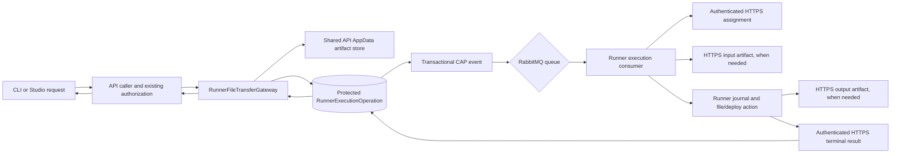

# Runner management transports

Updated: 3 October 2026.

This guide describes the Runner management transport after Slice 4 was merged and released as `e71ca380` on 2026-10-03. Focused production checks passed for app-file upload/download, media upload, and generic deployment package transfer through a Hosted Runner. Published media HTTP reads, in-flight cross-slot transfers, and cross-host package/artifact availability remain unverified.

## Durable operation path

RabbitMQ messages contain only operation and Runner identities. The executable request is protected at rest by the existing API Data Protection service. API replicas that serve a given operation must share its existing key ring and, for artifacts, the existing package volume. Runner delivery is journaled: a saved result is returned on redelivery, so completed work does not run again after a lost callback or restart. Accepted work whose outcome cannot be known is terminalized as `Lost`, rather than repeated.

`RunnerExecutionOperationService` routes media stats/metadata to the separate management queue. File writes, downloads, uploads and deployment work use the execution queue. The Runner processes them through `RunnerExecutionProcessor` and `RunnerFileTransferExecutor`; completed results are applied through the same authenticated HTTPS result endpoint as other durable Runner operations.

## File-transfer operations

| Operation | API caller | Queue | Runner behavior | Artifact direction |
| --- | --- | --- | --- | --- |
| App file upload | `AppFileUploadService` | Execution | Fetches bytes into the existing `Path.GetTempPath()/uploads/{session}` area | API store → Runner HTTPS GET |
| App file download | `AppFileDownloadService` | Execution | Reads the existing `Path.GetTempPath()/results/{session}` file | Runner HTTPS POST → API store → API response |
| Media upload | `AppMediaStorageService` | Execution | Writes into the app's existing data/media root | API store → Runner HTTPS GET |
| Media download | `AppMediaStorageService` | Execution | Reads the app media file after metadata lookup | Runner HTTPS POST → API store → API response |
| Media stats/metadata | `AppMediaStorageService` | Management | Reads current app media usage or file metadata | No artifact |
| Generic deployment fallback | `DeploymentPackageRunnerService` | Execution | Fetches the package and calls `RunnerDeploymentService` | API store → Runner HTTPS GET |

The Hosted Runner's existing package-deployment RabbitMQ/HTTPS path remains separate. Slice 4 migrates the generic Runner fallback and app file/media transfers; it does not alter Hosted Runner command dispatch.

## Authorization, bounds and storage

- App-facing API routes retain their existing authentication and app ownership checks. Before dispatch, `RunnerFileTransferGateway` verifies that the requested Runner remains assigned to a target owned by the requesting account.
- Artifact endpoints require the Runner API key and stable `X-Runner-Id`; the API authorizes that key against the persisted operation's Runner. Artifact reads/writes are refused for cancelled or terminal operations.
- Each transfer artifact is capped at 200 MiB. The existing `DeploymentPackageStore` capacity applies to the combined package and transfer files; defaults are 1 GiB and 100 files. Writes and expiry cleanup take the existing AppData lock file so API processes sharing that volume serialize capacity checks. No separate storage service or broker payload is introduced.
- Runner input requests pin their length and SHA-256 in the protected operation. Download results include the output length and SHA-256; the API checks both against the stored artifact before accepting a successful result.
- Inputs are deleted after a terminal result. Download outputs are deleted under the shared AppData storage lock after the API receives the persisted terminal result and finishes streaming them, so ordinary media reads do not accumulate files; abandoned outputs remain covered by expiry cleanup. Incomplete operations retain required inputs and outputs so retry/recovery can proceed.
- Each app-file download HTTP attempt gets a fresh operation ID, while the requested file session remains in the command. A prior `404`, or a successful operation whose output was later cleaned up, cannot poison a later retry using the same session.
- Blue/green API slots on the same host share `AppData/deployment-operations`. Availability when slots run on different hosts is **not established**. Do not treat same-host slot acceptance as proof of cross-host storage.

## SignalR after Slice 4

The file chunk registries, chunk DTOs, API chunk callbacks, `HubFileTransferService`, and `DeployAppPackage` Runner hub handler are removed. Workflow/custom-step execution, App Actions, managed-artifact synchronization, trusted host-container operations, host validation and storage telemetry use their migrated durable/API paths.

SignalR remains for independent Studio updates and supported BYO runtime tunnels. Runner registration/heartbeat, welcome/ping and reconnect-when-idle coordination also remain. Slice 5 will remove replaceable connection/drain coordination and API-slot registration gates after auditing the remaining dependencies; it must retain supported Studio and BYO behavior.

## Focused production validation — 2026-10-03

Runner pipeline #4951 passed from `e71ca380` and published `rzvdaniel/automaton-runner@sha256:4eda68e84a005730a15be3370a5b607211145fb6e817ac0baf8a6946195e272a`. The API was deployed to the blue color from the same revision, with the previous green API image retained. The protected Hosted Runner pin was backed up before updating; its reprovisioned container ran the published digest and registered with the new API color. The Infrastructure Runner remained on its previous digest and was not used to execute the file-transfer acceptance.

Using the retained unpublished app, authenticated app-file upload and download both completed through the Hosted Runner. Upload bytes staged by the Runner and download response bytes matched their expected SHA-256 values. A media upload completed and the persisted app-media bytes matched the expected SHA-256; its test file was removed. A supported CLI pull/deploy then uploaded five package files, applied them on the Runner, and returned a terminal successful deployment result without warnings. The app health endpoint returned `200 ready`, and its app-originated persistence marker endpoint returned HTTP 200 after deployment; this run did not capture a pre-deploy marker hash for comparison.

At verification, the active Hosted Runner execution, management and command queues each had one consumer and zero ready/unacknowledged messages. Production `prod-verify.sh` passed. Published media HTTP read was not exercised because the retained app is unpublished; the app was not made public for this check. The API blue/green pair shares one host, so cross-host artifact availability and a package fetch that begins before and completes after an in-flight slot switch remain unestablished. These results do not close Slice 5 or the combined RM recovery/cutover acceptance.
