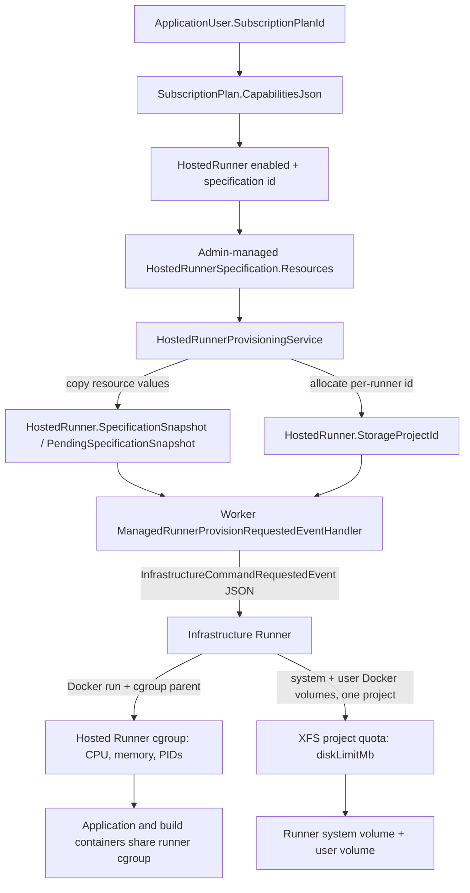

# Subscription Resource Policy Audit

**Status:** audit and contract only. No runtime behavior is changed by this document.

## Scope and conclusion

The subscription model currently controls feature eligibility and selection of a Hosted Runner specification. It does not define an account resource budget. The specification is administrator-managed and is the current source of Hosted Runner CPU, memory, disk, PID, shared-memory, logging, and per-runner app-capacity values. Provisioning snapshots those values onto each `HostedRunner`, then carries them through the Worker and Infrastructure Runner to Docker/cgroup and XFS enforcement.

The persisted `DiskLimitMb` is a per-Hosted-Runner limit. The current project quota aggregates the Hosted Runner's system and user Docker volumes under one XFS project. It is not account-wide across multiple Hosted Runners, Docker writable layers, image/cache data, or any storage outside those two Docker volume roots. Infrastructure Runner host resources and storage are operator-owned and remain outside tenant accounting.

## Current resource flow



The subscription resolver follows the plan capability to a specification; it does not resolve numeric resource limits directly. During provisioning, the selected specification is copied into the HostedRunner snapshot. Provisioning payloads use the pending snapshot when present, otherwise the persisted snapshot. Container-level app/build commands use the Hosted Runner cgroup and the Hosted Runner user volume.

## Resource authority table

| Resource | Current source of truth | Persisted where | Enforced where | Intended future source of truth |
| --- | --- | --- | --- | --- |
| Hosted Runner CPU | Admin-managed `HostedRunnerSpecification.Resources.CpuLimit`; code model default is 0.50, seeded Free row starts with model defaults unless edited | Specification and revision; copied to `HostedRunner.SpecificationSnapshot` (and pending snapshot for reprovision) | Infrastructure action creates runner cgroup with CPU quota; hosted Runner, app, and build containers join that parent cgroup | Subscription/account `SubscriptionResourcePolicy.CpuLimitCores`, materialized into runner spec/snapshot as needed |
| Hosted Runner memory | Admin-managed specification; model default 384 MiB | Specification/revision and runner snapshot | Runner cgroup memory limit; Docker memory reservation is also sent for the Hosted Runner container | `MemoryLimitMb` on account policy |
| Hosted Runner disk | Admin-managed `DiskLimitMb`; model default 512 MiB | Specification/revision; runner snapshot; `HostedRunner.StorageAllowanceBytes` derived from the spec | One XFS project hard quota over the Hosted Runner system and user Docker volume roots | `DiskLimitMb` on account policy, enforced once across every tenant-owned writable path for that account |
| Hosted Runner Tasks/PIDs | Admin-managed `PidsLimit`; model default 256 | Specification/revision and runner snapshot | Hosted Runner cgroup `pids.max`; app/build containers are descendants under the same runner cgroup | `TasksLimit` on account policy |
| Max Hosted Runners | No plan capability field. Provisioning looks up an existing non-deleted/non-disabled runner for the user and normally reuses it; this currently behaves as one active Hosted Runner per user in this path. No explicit subscription quota is modeled. | `HostedRunner` rows and their status/deletion state | API provisioning lookup/lifecycle, not host resource enforcement | `MaxHostedRunners` on account policy |
| Max applications | Specification `MaximumApps` (model default 3); not a plan-level or account-wide app count | Specification/revision and HostedRunner snapshot | `HostedRunnerAppCapacityService` checks deployment target assignments per Hosted Runner during assignment | `MaxApplications` on account policy (account-wide semantics should be decided; suggested contract treats this as account total) |
| Build concurrency | No subscription or Hosted Runner build concurrency limit found. Build commands have a per-build timeout; deployment operation/lease logic coordinates the same operation but is not a plan concurrency quota. Concurrent distinct builds can contend within the runner's aggregate cgroup/resources. | Deployment/operation state, not a resource-policy value | Runner execution timeout and shared cgroup; no policy-level admission limit identified | Keep out of the minimal policy until a product requirement and admission model exist |
| App container CPU/memory/PIDs | No app-specific resource values in the app deployment contract or Docker create request | No app resource snapshot found | App container is placed under its Hosted Runner's cgroup parent, so it shares the aggregate runner limit; no per-app Docker CPU/memory/PID limits are set | Account policy as aggregate cap; per-app subdivision is a later, separate feature if needed |
| App persistent data and declared storage mounts | App/application storage declarations select data subpaths; no app/account quota value | Hosted Runner user Docker volume under `workspace/data/{appId}/...` | Included in the Hosted Runner's shared XFS project only because it resides in that runner's user volume | Account `DiskLimitMb`, across apps, Hosted Runners, and other account-writable storage |
| Build workspace | Deployment source/package and Runner workspace layout; no disk allowance of its own | Hosted Runner user volume for brokered Hosted Runner builds, under `workspace/runner/deployments/...` | Included in that runner's user volume XFS project | Account `DiskLimitMb` |
| Build cache | No account resource policy. Application build/runtime cache directories may be created in the build workspace; Runner also has a `CacheRoot` workspace concept. No distinct capped or centrally accounted build cache was found in the Hosted Runner broker path. | Build output/cache that lands in the deployment source workspace is in the user volume; other Runner cache paths depend on runtime/workspace placement | User-volume quota only for writes under that volume. No separate cache quota | Account `DiskLimitMb` when disk-backed and tenant-owned |
| `/tmp` in app/build containers | Image/runtime defaults; no explicit tmpfs setting found in managed Docker app or build create/run arguments | Container writable layer unless image/runtime redirects it | No explicit tmpfs bound and no XFS project quota on the container writable layer | Bounded tmpfs (memory-backed and subject to account memory) |
| Hosted Runner `/tmp` | Runner image/container default; no tmpfs or size option in provision action | Hosted Runner container writable layer | Runner aggregate memory/PID/CPU cgroup, but not Hosted Runner XFS volume project quota | Bounded tmpfs (memory-backed); no persistent writable escape path |
| Writable root filesystem | Docker defaults to a writable container layer for Hosted Runner, apps, and builds; no `--read-only` or equivalent found on these paths | Docker storage driver/host Docker root, outside the two quota-assigned volume trees | Not covered by Hosted Runner XFS project quota. App/build cgroup placement limits CPU/memory/PIDs, not writable layer bytes | Read-only app/build root with explicit writable tmpfs and quota-accounted data/workspace mounts; bounded Hosted Runner mutable paths |
| Infrastructure Runner | Operator provisioning/configuration and host capacity; not selected as tenant policy | Infrastructure host/container/operator state | Infrastructure host/container boundary; it executes trusted host provisioning and is not charged to tenant XFS project | Remains outside tenant/account resource policy |

**Value caveat:** the requested approximate Free intent (0.5 CPU, 768 MiB, 2048 MiB, 128 PIDs) does not match the repository's model defaults (0.5, 384 MiB, 512 MiB, 256). Seed code creates the Free Hosted Runner specification with `new HostedRunnerResources()`, so fresh seeded data takes those code defaults. Existing operator-edited specification values take precedence after seeding because the seed does not overwrite an existing resource row. The live production values may therefore differ from both the approximate target and repository defaults; inspect the production admin specification to report its exact value.

## Assignments and propagation of limit values

| Value | Assignment / propagation path |
| --- | --- |
| `CpuLimit` | `HostedRunnerResources` defaults to 0.50; admin specification create/update persists operator-supplied values; Free seed creates defaults; `HostedRunnerSpecificationSnapshotFactory` copies the specification to a runner snapshot; provisioning chooses the specification; Worker serializes snapshot value as `cpuLimit`; `provision-hosted-runner` and `reprovision-hosted-runner` validate it and use it when ensuring the resource cgroup. |
| `MemoryLimitMb` | Same specification/default/snapshot path; Worker serializes `memoryMb`; Infrastructure action sets the hosted-runner cgroup memory ceiling and starts the Hosted Runner container under that cgroup. |
| `DiskLimitMb` | Same specification/default/snapshot path; API sets `StorageAllowanceBytes = DiskLimitMb * MiB`; Worker serializes `diskLimitMb`; Infrastructure action applies one project hard block quota to the two Hosted Runner volume roots. Host scheduling also reserves this per-runner estimate; it is not aggregate tenant accounting. |
| `PidsLimit` / Tasks | Same specification/default/snapshot path; Worker serializes `pidsLimit`; Infrastructure action writes the runner cgroup PID ceiling. App and build containers inherit the shared cgroup tree. |
| `MaximumApps` | Specification default/admin value copied to the snapshot. `HostedRunnerAppCapacityService` reads the persisted runner snapshot during runner assignment. |

Relevant implementations: `src/Automaton.Infrastructure/Models/HostedRunnerSpecifications.cs`, `src/Automaton.Api/Extensions/DataExtensions.cs`, `src/Automaton.Api/Services/HostedRunnerSpecificationResolver.cs`, `src/Automaton.Api/Services/HostedRunnerProvisioningService.cs`, `src/Automaton.Worker/Handlers/ManagedRunnerProvisionRequestedEventHandler.cs`, and `system-apps/automaton-infrastructure/actions/{provision-hosted-runner,reprovision-hosted-runner}/main.py`.

## `StorageProjectId` ownership assumptions

Today this is explicitly a **HostedRunner-owned XFS project identity**, not an account identity:

1. `HostedRunner.StorageProjectId` is a nullable field on `HostedRunner`, with a unique database index.
2. `HostedRunnerProvisioningService.AllocateStorageProjectIdAsync(hostedRunnerId)` chooses an unused value by hashing the HostedRunner ID and probing all other HostedRunner rows. It does not use an account ID or account disk-budget record.
3. `ManagedRunnerProvisionRequestedEventHandler` requires that HostedRunner field and serializes it as `xfsProjectId` alongside `hostedRunnerId`, `systemVolumeName`, and `userVolumeName`.
4. The Infrastructure Runner action validates both volume names against the HostedRunner ID, then assigns the same project ID to those two volume roots and sets one hard quota for the project.
5. `HostedRunnerStorageReconciliationService` reads the `StorageProjectId` through the verification's HostedRunner and dispatches the same HostedRunner-scoped volume names and project ID for measurement.
6. The telemetry fallback derives the storage allowance from the HostedRunner snapshot's `DiskLimitMb`.
7. `HostedRunnerManagementService` derives system/user volume names from the HostedRunner ID for deletion actions.
8. The uniqueness index is only among HostedRunner values; it does not reserve an account project shared across multiple HostedRunners or other tenant storage roots.

This ownership shape means the current quota cannot implement the intended one-budget-per-account model. Future account-level accounting will need a durable account-level quota identity and a controlled way to associate all account-owned writable roots/paths with it; the migration is explicitly outside this audit stage.

## Writable tenant disk paths found

### Paths currently inside the Hosted Runner XFS project

- Hosted Runner system Docker volume: provisioned as `automaton-hosted-runner-{id}-system`, mounted at `/automaton/system`. Includes writable Runner system state/configuration that is actually placed there.
- Hosted Runner user Docker volume: `automaton-hosted-runner-{id}-user`, mounted at `/automaton/storage`.
- Runner workspace below the user volume: `workspace/apps/...` for runtime candidate artifacts; `workspace/data/{appId}/...` for app data and declared storage mounts; `workspace/runner/deployments/...` for deployment staging/source/build workspaces; and other user workspace content written under the configured workspace root.
- Brokered hosted app containers mount accepted application artifacts read-only at `/automaton/app`, and data/mount subpaths from the user volume read-write at `/automaton/data` and `/automaton/data/{mount}`.
- Brokered build containers mount the incoming deployment source subpath in the same user volume read-write at `/automaton/source`.

The XFS quota counts all blocks charged to those two volume roots under the same project ID, including user storage and app/build workspaces within the user volume. This is aggregate across these two volumes for one HostedRunner only.

### Tenant-writable paths currently outside that XFS project

- The Hosted Runner container writable layer, including its default `/tmp`, any path not on `/automaton/system` or `/automaton/storage`, and writes to image/container overlay state.
- Hosted app container writable layers, including app `/tmp`, despite `/automaton/app` being read-only and `/automaton/data` being mounted separately.
- Build container writable layers and `/tmp`; only the source workspace is mounted from the quota-assigned user volume.
- Any Runner workspace/cache directory whose configured root is not the brokered Hosted Runner user volume. The direct/local Runner Docker path uses host bind mounts (`DockerContainerRuntime`) and is not the same enforcement path as Hosted Runner brokered execution.
- Docker image layers, build/pulled image cache, Docker logs, container metadata, and other Docker host storage live in the Infrastructure Runner host Docker root. These are infrastructure-owned shared host resources and do not consume the tenant XFS project. Per-runner Docker local log rotation is configured, but logs are not part of the tenant quota.

### Disk-accounting escape paths / limitations

- Docker writable layers are not under either project-tagged Hosted Runner volume.
- `/tmp` is not explicitly mounted as tmpfs, has no configured size bound, and is not under the project quota.
- Build dependency/cache data can be in the source workspace (quota-covered) or image/container writable layer (not quota-covered); there is no single explicit build-cache root/quota.
- Multiple Hosted Runners for one account would each get their own project and full per-runner `DiskLimitMb`; the current model does not sum tenant storage across them.
- App data and app declared volumes are quota-covered only when they are routed through the Hosted Runner's brokered user volume. Other/local/self-hosted execution storage is outside this Hosted Runner quota by design.
- Host scheduling checks estimated per-runner disk reservations against host-reported capacity. That is placement admission, not account usage accounting or quota enforcement.

Infrastructure Runner's own system, image cache, command workspace, and host storage are deliberately not charged to the tenant quota. Keep that distinction when adding tenant-wide accounting.

## Current `/tmp` and root filesystem behavior

No explicit `--tmpfs /tmp`, size limit, or equivalent is configured for the Hosted Runner, application, or build container creation paths found in the repository. Docker therefore supplies its normal writable container root layer (including `/tmp` unless the image changes it). `/tmp` writes can consume host Docker storage outside the HostedRunner-owned XFS project. CPU/memory/PID cgroup limits do not provide a disk byte cap.

The Hosted Runner's `/automaton/system` and `/automaton/storage` are persistent named Docker volume mounts. Its other writable paths remain in the container layer. App artifacts at `/automaton/app` are mounted read-only, which protects the accepted artifact tree, but the app root filesystem as a whole is not read-only: the container receives no read-only root setting and retains writable-layer paths. `/automaton/data` and declared storage paths are explicit writable mounts inside the quota-assigned Hosted Runner user volume on the brokered path. Build source is writable and quota-covered on that path, but build rootfs and tmp remain writable outside it.

## Docker volume behavior for app and build execution

- **Brokered Hosted Runner apps:** `HostContainerExecutionService.CreateApplicationContainerAsync` verifies the HostedRunner-labeled user volume, mounts candidate artifact subpath read-only, mounts app data and declared storage subpaths read-write, and places the container in the HostedRunner cgroup. No per-app CPU/memory/PID limit, read-only rootfs, or tmpfs is added.
- **Brokered Hosted Runner builds:** `HostContainerExecutionService.RunBuildAsync` mounts the deployment attempt source subpath from the HostedRunner user volume. It uses the HostedRunner cgroup, but does not mount a dedicated cache or tmpfs and does not make rootfs read-only.
- **Direct/local Runner Docker runtime:** `DockerContainerRuntime` uses host bind mounts for build source, app artifacts (read-only), and app data/storage (read-write). It does not set account policy limits; it is not the Infrastructure Runner brokered Hosted Runner path.
- **Hosted Runner system/user volumes:** provision and reprovision actions create/retain both named volumes, attach the same XFS project, and verify one `diskLimitMb` hard block quota for the project. Reconciliation measures those expected volumes by HostedRunner-scoped identity.

## Minimal future contract

Keep the contract limited to the requested account policy values and avoid product-tier or organization-specific abstractions for now:

```csharp
public sealed record SubscriptionResourcePolicy
{
    public decimal CpuLimitCores { get; init; }
    public int MemoryLimitMb { get; init; }
    public int DiskLimitMb { get; init; }
    public int TasksLimit { get; init; }
    public int MaxHostedRunners { get; init; }
    public int MaxApplications { get; init; }
}
```

Store/resolve this policy from the effective account subscription (the user plan is the current effective subscription link). The policy should be the authoritative ceiling. Hosted Runner specifications may continue to describe an operator-approved runtime shape, but resolution must not allow that shape to exceed policy, and persisted provisioning snapshots should capture the effective limits used for a particular provision/reprovision operation.

`DiskLimitMb` means one account-level aggregate writable-disk budget. `StorageProjectId` should evolve from a HostedRunner-owned identity to an account-owned quota identity (or equivalent shared ownership mapping) so all account roots are charged to the same quota. Infrastructure Runner host state, image cache, and host Docker storage remain outside that tenant budget. Keep `/tmp` bounded and memory-backed. Do not add separate build concurrency, per-app CPU, paid tiers, or organization policy fields without a corresponding product requirement.

## Recommended migration sequence

1. **Policy contract and resolver:** add the small policy shape to the effective account/subscription model and make resource lookup deterministic. Define whether max applications is per account; this audit recommends account-wide because policy is account-scoped.
2. **Hosted Runner snapshot and validation:** resolve policy together with the selected operator specification; reject or clamp spec values above policy explicitly; persist effective CPU, memory, disk, task, max-runner and app caps with provisioning operations. Keep old snapshots readable during rollout.
3. **Admission limits:** enforce `MaxHostedRunners` and `MaxApplications` transactionally at account scope; add resource/build admission only if separately specified.
4. **Account storage ownership design:** add account-level quota identity and mapping before moving any existing data. Inventory roots, handle XFS project ownership safely, and plan rollback/reconciliation. Do not migrate storage until that design is reviewed.
5. **Close disk escapes:** stage mount and image/log accounting decisions; make app/build rootfs read-only where compatible; provide explicit writable quota-backed paths and bounded tmpfs `/tmp`; ensure build temporary output/cache lands in accounted workspace or bounded tmpfs. Preserve infrastructure-owned storage outside tenant accounting.
6. **Enforcement and observability:** apply aggregate account quota across all account paths, report account usage from trusted host measurements, and test exhaustion and provisioning/reprovision recovery before changing production policy values.

This sequence is a recommendation only; this task does not begin Stage 2 or implement migrations.

## Principal code references

- `src/Automaton.Infrastructure/Models/PlanCapabilities.cs` — plan capabilities currently include HostedRunner enablement/specification mapping and scheduled-action limits, but no resource budget.
- `src/Automaton.Infrastructure/Models/HostedRunnerSpecifications.cs` — resource code defaults and specification snapshot copying.
- `src/Automaton.Infrastructure/Entities/SubscriptionPlan.cs`, `src/Automaton.Infrastructure/Entities/ApplicationUser.cs` — plan storage and user-to-plan association.
- `src/Automaton.Api/Extensions/DataExtensions.cs` — Free plan/specification seed defaults.
- `src/Automaton.Api/Services/HostedRunnerSpecificationResolver.cs` — plan-to-specification resolution.
- `src/Automaton.Api/Services/HostedRunnerProvisioningService.cs` — snapshot persistence, storage allowance/project allocation, host placement reservations.
- `src/Automaton.Worker/Handlers/ManagedRunnerProvisionRequestedEventHandler.cs` — provisioning payload from persisted snapshot and HostedRunner `StorageProjectId`.
- `system-apps/automaton-infrastructure/actions/provision-hosted-runner/main.py` and `reprovision-hosted-runner/main.py` — host cgroup and XFS project setup; volume mount list; Docker runner launch.
- `src/Automaton.Runner/Services/HostContainerExecutionService.Runtime.cs` and `HostContainerExecutionService.cs` — brokered app/build container mounts and cgroup placement.
- `src/Automaton.Runner/Services/DockerContainerRuntime.cs` — direct/local Docker bind mounts and absence of corresponding resource policies.
- `src/Automaton.Worker/Services/HostedRunnerStorageReconciliationService.cs`, `src/Automaton.Api/Services/RunnerStorageTelemetryService.cs` — HostedRunner-scoped measurement/allowance handling.
