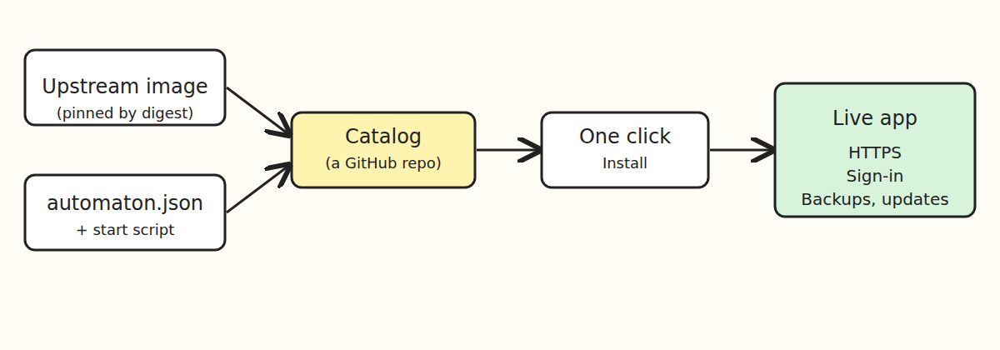
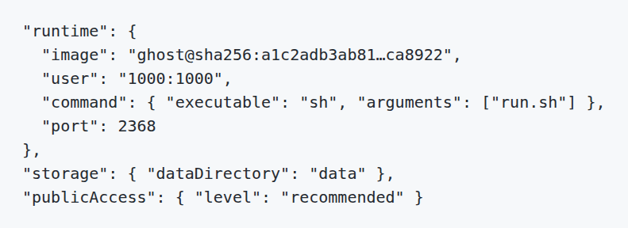
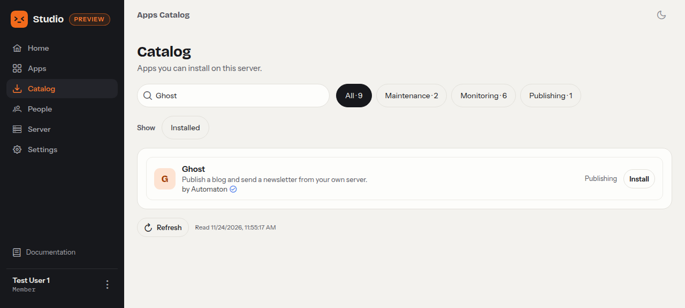
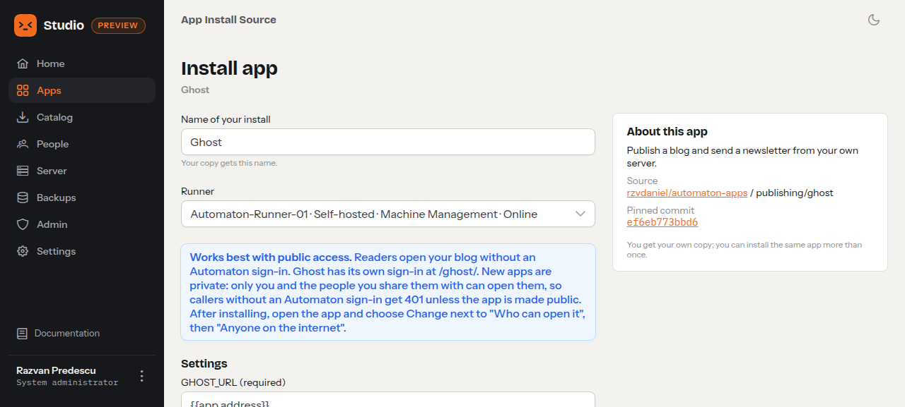
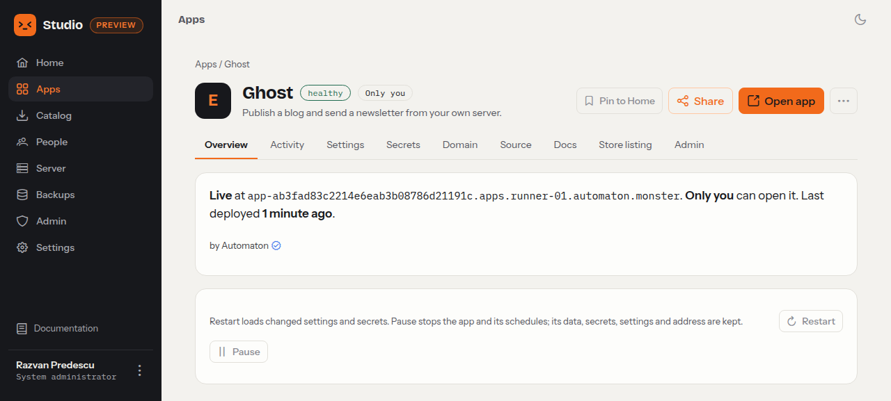
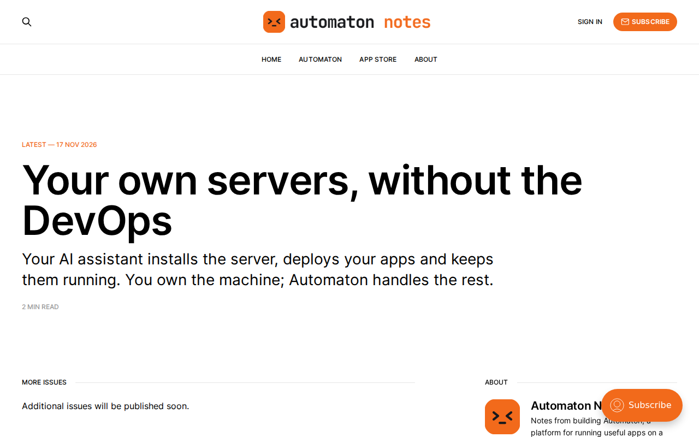

# We didn't write our blog. We installed it.

Our blog is Ghost. We never set Ghost up: no server to prepare, no certificate to request, no database to wire. We installed it from the Automaton catalog, like an app on a phone.

TODO(owner): one sentence in your own voice about why you wanted a blog on your own server.

## The usual self-hosting pain

You find a great open-source app. Then comes the afternoon: pick a container image, work out which port and which folder need to survive a restart, put a reverse proxy in front, get HTTPS, add a sign-in, remember backups, and keep it updated next month. The app took five minutes. Everything around it took the day. And the day comes back every time something changes: a new version, a full disk, a certificate that expired while you were on holiday.

## What a package is

In Automaton, an app is a folder with one file, `automaton.json`. For Ghost it names the upstream image (pinned by digest, so it never changes under you), the port it listens on, the folder where its data lives, and whether readers can open it without signing in. A few optional settings let you add Mailgun for newsletters. Next to it sits a small start script. That is the whole packaging. Nobody had to rebuild Ghost or fork it: we point at the image its authors publish, and the license stays theirs.

Automaton adds the rest: HTTPS, sign-in, backups and updates.

## Install it in 3 steps

**1. Open the Catalog.** Ghost is a card under Publishing.

**2. Click Install.** The address is filled in for you. Pick a name and press Install.

**3. Open it.** The app page has two links: Blog for readers and Admin for you. New apps start private, so one more choice ("Who can open it" → "Anyone on the internet") makes the blog public.

That is the blog you are reading, in its production form:

## Your own catalog

The catalog is just a GitHub repository with folders like these. Point Automaton at any repository and its apps appear the same way.

TODO(owner): do you want to say here which open-source app you would like to see packaged next?

## The number

On our test server (Automaton 0.2.186, Ghost 6.77), a fresh Ghost install took **3 clicks** from the catalog card to a running install, then one more to open the blog. From pressing Install to a running blog took **under 2 minutes**.

Try it, or package your own: <https://automaton.monster>
