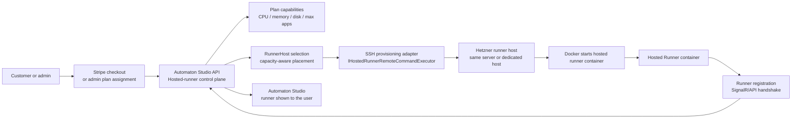

# Hosted Runner SSH Provisioning

Automaton can provision one paid hosted runner container per user by SSH-ing from the API container into a configured Hetzner runner host.

## Architecture

The Automaton API is the hosted-runner **control plane**. We do not run a separate provisioning app today.



In plain words: payment or admin assignment tells Automaton that a user deserves a hosted runner. Automaton reads the plan, picks a suitable host, SSHes into that machine, starts the runner container with Docker, waits for that runner to register back, and only then exposes it as a usable runner in Studio.

The key distinction is that **Automaton decides and orchestrates**, while **Hetzner only hosts the actual container**.

This works for both layouts:

- **Same-server testing**: the API SSHes into the current Hetzner server and starts hosted runner containers there.
- **Dedicated runner hosts**: the API SSHes into one or more separate Hetzner servers that only host paid user runner containers.

Each host is represented by a `RunnerHost` row with public IP and capacity. The scheduler picks a host with enough remaining CPU, memory, and disk budget, so adding more Hetzner servers later does not change the business flow.

## Server Configuration

In `/opt/automaton/config/appsettings.Production.json`, configure:

```json
{
  "HostedRunners": {
    "Enabled": true,
    "DeploymentMode": "sshDocker",
    "ServerUrl": "https://api.automaton.monster",
    "DockerImage": "rzvdaniel/automaton-runner:latest",
    "DockerNetwork": "automaton_runner_network",
    "DataRoot": "/opt/automaton/hosted-runners",
    "SshUsername": "automaton-runner-provisioner",
    "SshPort": 22,
    "SshPrivateKeyPath": "/run/secrets/hosted_runner_ssh_key",
    "SshPrivateKeyPassphrase": "",
    "SshConnectTimeoutSeconds": 20,
    "SshCommandTimeoutSeconds": 180
  }
}
```

The production Compose stack mounts:

```text
/opt/automaton/secrets/hosted_runner_ssh_key
```

into the API container at:

```text
/run/secrets/hosted_runner_ssh_key
```

## Hetzner Runner Host Setup

Each Hetzner runner host needs:

- a dedicated provisioning user with Docker access
- a writable hosted-runner data root
- the Automaton provisioning public key in that user's `authorized_keys`

The Automaton production server also needs the matching private key file available before the API container is redeployed.

Use the full checklist in [Administrator Step-by-Step](#administrator-step-by-step) for the exact commands, ordering, and validation steps.

## Automaton Admin Flow

1. Open `Admin -> Hosted Runners`.
2. Add a runner host with its public IP and capacity.
3. Create or edit a subscription plan whose hosted-runner capability is enabled.
4. Assign the plan to a test user or complete Stripe test checkout.
5. Automaton SSH-provisions the container.
6. Once the container registers back with the API, the hosted runner becomes `running`.

Failed or pending hosted runners can be retried from `Admin -> Hosted Runners`.

If Docker starts the hosted runner container but the hosted runner stays in `provisioning`, inspect that container's logs on the selected runner host. The most common first-launch failure is a permissions error on the bind-mounted data folders, for example:

```text
mkdir: cannot create directory '/app/data/apps': Permission denied
```

Hosted runner provisioning now fixes ownership automatically before launching the container, but older pending runners created before that fix may need the one-time recovery command shown in [Retry failed provisioning](#10-retry-failed-provisioning).

## Administrator Step-by-Step

Use this checklist when setting up hosted runner subscriptions for the first time.

### 1. Prepare the Hetzner runner host

**In plain words:** this is the machine that will physically run paid users' Runner containers. We prepare one dedicated Linux account that Automaton is allowed to use for provisioning, give it Docker access, and create the disk area where each user's hosted runner can keep its files.

On the server that will host paid user runner containers:

```bash
sudo useradd --create-home --shell /bin/bash automaton-runner-provisioner
sudo usermod -aG docker automaton-runner-provisioner
sudo mkdir -p /opt/automaton/hosted-runners
sudo chown -R automaton-runner-provisioner:automaton-runner-provisioner /opt/automaton/hosted-runners
```

You can do this:

- on the same Hetzner server that runs Automaton, for early testing
- on a separate Hetzner server dedicated to hosted runners

### 2. Create the SSH provisioning key

**In plain words:** Automaton needs a safe way to log in to the runner host without a password prompt. The private key stays with the Automaton API server; the public key is copied to every runner host that Automaton is allowed to manage.

Generate the SSH key pair on the Automaton production server:

```bash
sudo mkdir -p /opt/automaton/secrets
sudo ssh-keygen -t ed25519 -f /opt/automaton/secrets/hosted_runner_ssh_key -N ""
sudo chmod 600 /opt/automaton/secrets/hosted_runner_ssh_key
sudo chmod 644 /opt/automaton/secrets/hosted_runner_ssh_key.pub
```

This stores the private key at:

```text
/opt/automaton/secrets/hosted_runner_ssh_key
```

and the public key at:

```text
/opt/automaton/secrets/hosted_runner_ssh_key.pub
```

Add the public key contents to:

```text
/home/automaton-runner-provisioner/.ssh/authorized_keys
```

on every runner host server.

Create the runner host SSH directory if needed:

```bash
sudo mkdir -p /home/automaton-runner-provisioner/.ssh
sudo chmod 700 /home/automaton-runner-provisioner/.ssh
sudo touch /home/automaton-runner-provisioner/.ssh/authorized_keys
sudo chmod 600 /home/automaton-runner-provisioner/.ssh/authorized_keys
sudo chown -R automaton-runner-provisioner:automaton-runner-provisioner /home/automaton-runner-provisioner/.ssh
```

Then append the public key contents to `authorized_keys`.

If the Automaton API server and the runner host are the same machine, use:

```bash
sudo sh -c 'cat /opt/automaton/secrets/hosted_runner_ssh_key.pub >> /home/automaton-runner-provisioner/.ssh/authorized_keys'
sudo chown automaton-runner-provisioner:automaton-runner-provisioner /home/automaton-runner-provisioner/.ssh/authorized_keys
```

If the runner host is a different Hetzner server:

1. On the Automaton production server, print the public key:

```bash
sudo cat /opt/automaton/secrets/hosted_runner_ssh_key.pub
```

2. Copy the full single line that is printed.
3. On the runner host, open:

```bash
sudo nano /home/automaton-runner-provisioner/.ssh/authorized_keys
```

4. Paste the public key on its own line, save, and exit.
5. Reapply ownership if needed:

```bash
sudo chown automaton-runner-provisioner:automaton-runner-provisioner /home/automaton-runner-provisioner/.ssh/authorized_keys
```

Do this **before** redeploying the API container. The Compose bind mount expects `/opt/automaton/secrets/hosted_runner_ssh_key` to be a real file. If the path is missing during redeploy, Docker can create a directory with that name instead, which looks mounted but cannot be used as an SSH private key.

### 3. Configure Automaton production settings

**In plain words:** this tells the API server that hosted runner provisioning is turned on, that SSH-based deployment should be used, which Runner image to start, and where its SSH credentials live inside the API container.

In:

```text
/opt/automaton/config/appsettings.Production.json
```

set:

```json
{
  "HostedRunners": {
    "Enabled": true,
    "DeploymentMode": "sshDocker",
    "ServerUrl": "https://api.automaton.monster",
    "DockerImage": "rzvdaniel/automaton-runner:latest",
    "DockerNetwork": "automaton_runner_network",
    "DataRoot": "/opt/automaton/hosted-runners",
    "SshUsername": "automaton-runner-provisioner",
    "SshPort": 22,
    "SshPrivateKeyPath": "/run/secrets/hosted_runner_ssh_key",
    "SshPrivateKeyPassphrase": "",
    "SshConnectTimeoutSeconds": 20,
    "SshCommandTimeoutSeconds": 180
  }
}
```

### 4. Redeploy the Automaton API

**In plain words:** after changing code and configuration, the production API container must be rebuilt/restarted so it actually contains the SSH provisioning logic and can see the mounted SSH key.

Deploy the latest API version so the SSH provisioning adapter is available in production.

The production Compose stack mounts:

```text
/opt/automaton/secrets/hosted_runner_ssh_key
```

into the API container at:

```text
/run/secrets/hosted_runner_ssh_key
```

After redeploying, verify that the active API container can see the mounted private key file.

First check which color is live:

```bash
./scripts/prod-switch-blue-green.sh status
```

Then run the check against the active API container, for example:

```bash
docker exec automaton-prod-api-blue-1 sh -lc 'ls -l /run/secrets/hosted_runner_ssh_key'
```

or:

```bash
docker exec automaton-prod-api-green-1 sh -lc 'ls -l /run/secrets/hosted_runner_ssh_key'
```

You should see a normal file entry, for example one starting with `-rw`, not output like `total 0`.

You can also verify the path is readable:

```bash
docker exec automaton-prod-api-blue-1 sh -lc 'test -r /run/secrets/hosted_runner_ssh_key && echo readable || echo missing-or-unreadable'
```

Use `green-1` instead of `blue-1` when green is live.

### 5. Add the runner host in Automaton Studio

**In plain words:** now we introduce that Hetzner machine to Automaton. This creates a schedulable host record, so the system knows where it is allowed to place paid users' runner containers and how much capacity that machine has.

In Studio:

1. Open `Admin -> Hosted Runners`.
2. Click `Add Host`.
3. Enter:
   - a readable name, for example `Hetzner CX23 - Nuremberg`
   - provider `hetzner`
   - public IP of the server
   - total CPU, memory, and disk capacity
   - status `active`
4. Save the host.

### 6. Create or update a hosted-runner subscription plan

**In plain words:** the subscription plan is what decides whether a paying user should receive a managed Runner, and how large that Runner is allowed to be. These plan limits become the CPU, memory, disk, and app limits used during provisioning.

In Studio:

1. Open `Admin -> Subscription Plans`.
2. Create a new plan or edit an existing one.
3. Enable hosted runner support.
4. Set:
   - CPU cores
   - memory MB
   - disk MB
   - max apps
   - visibility
5. Save the plan.

For internal production testing, set visibility to `testUsersOnly`.

Then go to:

```text
Admin -> Subscription Plans -> User Plans
```

and enable `Test runner plans` for the specific test users who should be allowed to see that plan in Pricing and complete Stripe test checkout. Users without that flag will not see the plan and cannot start checkout for it.

### 7. Test the real purchase flow

**In plain words:** do not create a fake "test provisioning" path. Use the exact same flow we want for real customers, either by assigning the plan manually as an admin or by completing a Stripe test purchase.

Use either path:

- assign the plan manually to a test user from Admin
- complete a Stripe test checkout for that plan

Both use the same provisioning code path.

### 8. Watch provisioning status

**In plain words:** this is where you confirm that the whole chain worked: Automaton created the hosted-runner record, picked a host, connected over SSH, started Docker remotely, and finally saw the Runner come back online and register itself.

Open:

```text
Admin -> Hosted Runners
```

You should see the new hosted runner for that user.

Expected lifecycle:

1. Automaton creates a hosted-runner record.
2. It selects a host with enough spare capacity.
3. It creates a temporary runner-scoped API key.
4. It SSHes into the selected host.
5. It starts the Docker container remotely.
6. The runner container registers back with Automaton.
7. The hosted runner becomes `running`.

### 9. Verify the user experience

**In plain words:** infrastructure is only half the story. The user should not need to know about SSH, Docker, or Hetzner. They should simply see a ready-to-use hosted Runner in the product.

Log in as the test user and confirm:

- the hosted runner appears in the normal Runners area
- it is available for app/flow execution choices where runners are used

### 10. Retry failed provisioning

**In plain words:** if something was misconfigured, such as SSH access or Docker permissions, you do not need to recreate the subscription from scratch. Fix the server/config issue, then ask Automaton to try provisioning that same hosted runner again.

If a hosted runner stays pending or fails:

1. Open `Admin -> Hosted Runners`.
2. Find the hosted runner.
3. Click `Retry`.

Automaton will rotate the temporary runner registration key and attempt provisioning again.

If the deployment attempt says Docker succeeded but the hosted runner remains `provisioning`, inspect the actual container on the selected runner host:

```bash
docker ps --filter "name=automaton-hosted-runner-..."
docker logs --tail 200 automaton-hosted-runner-...
```

If the container is restarting with:

```text
mkdir: cannot create directory '/app/data/apps': Permission denied
```

then the host bind mounts were created without ownership for the non-root `automaton` user inside the Runner image. For an already-created hosted runner, repair ownership once on the runner host:

```bash
sudo chown -R 1000:1000 /opt/automaton/hosted-runners/<hosted-runner-id>/config
sudo chown -R 1000:1000 /opt/automaton/hosted-runners/<hosted-runner-id>/data
sudo chown -R 1000:1000 /opt/automaton/hosted-runners/<hosted-runner-id>/logs
docker restart automaton-hosted-runner-...
```

After the container starts cleanly, it should register back with Automaton and move from `provisioning` to `running`.

### 11. Add more Hetzner servers later

**In plain words:** scaling out does not change the subscription flow. You add more machines, give them the same provisioning access, register them in Admin, and Automaton can start placing new hosted runners on whichever active host still has room.

When current runner hosts approach capacity:

1. Prepare another Hetzner server using the same setup steps.
2. Add the same SSH public key to that host.
3. Add it in `Admin -> Hosted Runners`.

New hosted runners can then be allocated to any active host with enough capacity.

## Subscription Flow

The same provisioning path is used for:

- Stripe checkout completion
- Stripe subscription plan changes
- manual Admin subscription-plan assignment

That is intentional. Test-mode Stripe purchases and real paid purchases exercise the same code path.

The sequence is:

1. User gets a hosted-runner-enabled subscription plan.
2. Automaton creates or refreshes a `HostedRunner` row.
3. Automaton selects a `RunnerHost` with spare capacity.
4. Automaton creates a temporary runner-scoped API key.
5. The SSH adapter starts the Docker container remotely.
6. The container registers with the Automaton API using its runner name.
7. The hosted runner is linked to the registered `Runner` row and becomes `running`.

## Security Notes

- The API never stores raw generated runner API keys.
- Retry provisioning rotates the temporary runner registration key when the first container has not registered yet.
- Use a dedicated SSH user, not `root`.
- Keep the SSH private key outside the repo and readable only by the server operator.
- The current adapter executes only Automaton-generated runner deployment scripts, not arbitrary admin-entered shell.
