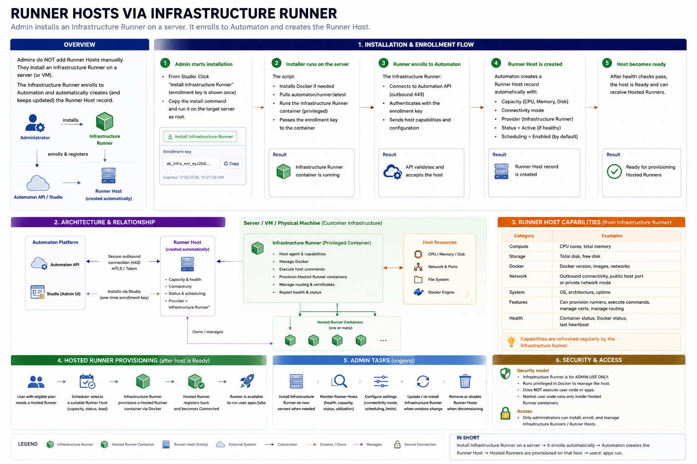

# Add a Runner Host

## Goal

Register a server that can host managed runner containers.

## Server prerequisites

Prepare the target server with:

- a supported operating system;
- Docker installed and accessible to the Infrastructure Runner;
- a fixed-capacity XFS filesystem mounted separately from `/`, with XFS project quota support enabled;
- Docker configured with the `overlay2` storage driver and its data root on that filesystem;
- required ports available;
- outbound connectivity to the Automaton API;
- sufficient CPU, memory, and disk;
- the required Docker network;
- the configured runtime directories;
- permissions for the Infrastructure Runner to execute the required host operations.

The exact provisioning transport and runtime connectivity mode determine which network and directory settings apply.

Before enabling scheduling, verify the active paths on the host:

```text
docker info --format '{{.Driver}}'
docker info --format '{{.DockerRootDir}}'
findmnt --target / --output TARGET,SOURCE,FSTYPE,UUID,OPTIONS
findmnt --target <docker-data-root> --output TARGET,SOURCE,FSTYPE,UUID,OPTIONS
```

Hosted Runner provisioning requires Docker's `overlay2` storage driver, whose image and writable-layer data resides under Docker's data root. Configure that root on the fixed-capacity XFS filesystem. Its mount must have a different filesystem UUID from `/`; a bind mount backed by the OS filesystem does not qualify. Telemetry verifies the driver, XFS type, mount identity, and project quota options. Until a current Infrastructure Runner reports a verified layout, the host cannot receive Hosted Runner placement or Docker image operations. After rollout, existing Infrastructure Runner host measurements are marked stale and must be refreshed by the updated Runner before the host is eligible again.

An administrator must prepare or reuse the fixed-capacity filesystem and configure Docker's data root explicitly. Formatting, mounting, changing Docker configuration, and moving existing data are host setup operations; Automaton does not perform them as repair. Docker named volumes remain under their existing XFS project quotas. If they share this filesystem, its physical capacity bounds tenant volumes and platform image/cache storage together; it does not create a separate image-only quota. Automaton retains host free-space reserves and may prune dangling, untagged Docker images after verification; it never runs the broad `--all` prune that would remove tagged rollback images.

## Where

Admin → Runners → Runner Hosts

Host records can include a name, provider, region, public IP, private IP, provisioning transport, runtime connectivity mode, and capacity values. Use stable names such as `hetzner-fsn1-runner-01` or `runtime-local-docker`. Public Host Port connectivity requires a usable public IP; Local Docker Network is intended for local development.

Capacity includes total and reserved CPU, memory, and disk. Schedulable capacity is calculated as:

```text
Available capacity = Total - Reserved - Existing runner allocations
```

CPU and memory admission reserve the larger of each occupying Hosted Runner's current and pending limits, separately for each resource. A pending upgrade reserves its increase immediately; a pending downgrade does not release capacity until Runner registration confirms the new specification. The Runner being resized is counted once, using at least its existing reservation and the requested limits. Host CPU and memory reserves remain unavailable for tenant placement.

Disk admission counts each Hosted Runner's specification XFS disk limit, separately bounded writable root layer, and configured maximum Docker log storage. The root layer and Docker logs are platform overhead outside the account XFS project quota.

## Onboarding sequence

Administrators normally add remote Runner Hosts by installing and enrolling an Infrastructure Runner. The Infrastructure Runner reports host capabilities to Automaton and keeps the host record updated. Follow the detailed [Infrastructure Runner installation and maintenance](./infrastructure-runners.md) guide for the generated command and host-side procedure.

[](./assets/runner-hosts-via-infrastructure-runners.png)

1. Open **Admin → Runners → Runner Hosts**.
2. Choose **Install Infrastructure Runner** for the target host and run the provided installer on the target server.
3. Wait for enrollment and confirm that the Infrastructure Runner appears online.
4. Validate the host. Validation is read-only: it reports missing prerequisites and does not silently repair the server. The installer and Infrastructure Runner setup perform the installation work; there is no separate **Prepare host** action in the current admin UI.
5. Approve the host when the administrator trusts it for managed workloads.
6. Approval automatically enables Hosted Runner scheduling.

## Ready conditions

A host is scheduling-eligible only when the Infrastructure Runner is online, validation succeeded, approval is complete when required, scheduling is enabled, the host is active, and enough capacity remains for the requested specification.
