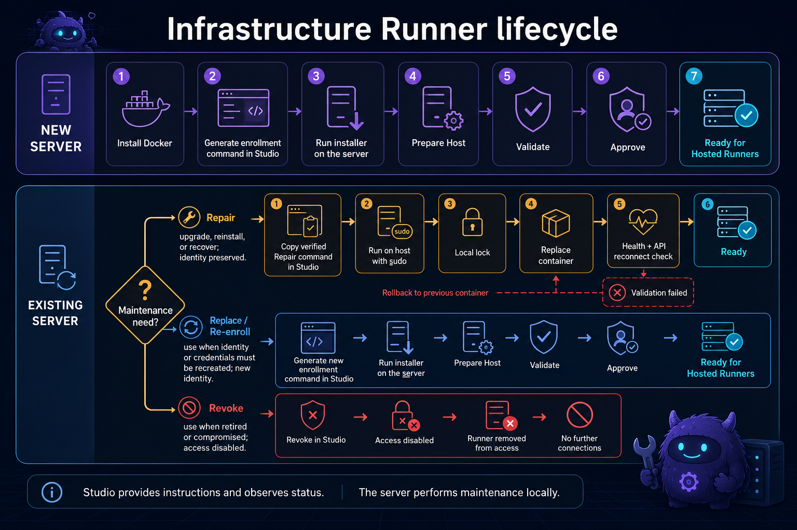

Use this page when adding a new Runner Host or maintaining an existing Infrastructure Runner. Studio provides verified commands and observes the result; maintenance runs locally on the server.

## Install on a new server

1. Prepare a Linux server with administrator access and install Docker.
2. In Studio, open **Admin → Infrastructure Runners → Enrollment keys**.
3. Select **Create enrollment key** and copy the installation command.
4. Connect to the new server using SSH or its console, then run the copied command with `sudo`.
5. Return to **Admin → Infrastructure Runners** and open the newly registered runner.
6. Select **Prepare host**, wait for it to finish, then select **Validate host**.
7. Correct any reported problems and validate again. When validation succeeds, select **Approve**.
8. Enable Hosted Runner scheduling if applications should be placed on this server.

Confirm that the runner shows **Online**, **Ready**, successful validation, the expected image digest, and scheduling enabled when required. The server is then ready to host managed Runners.

## Update or repair an existing Infrastructure Runner

Use **Update / Repair** to update, reinstall, or recover the container without changing its identity or configuration.

It preserves the installation ID, API credential, `runner.json`, `installation-profile.json`, and other persisted configuration.

1. Open **Admin → Infrastructure Runners** and select the server.
2. Select **Update / Repair**, review the installed image digest, and select **Copy command**.
3. Connect to the Runner Host and run the copied command with `sudo`.
4. Wait for the installer to finish, then return to Studio and refresh the details.
5. Confirm that the runner reconnected, is **Online** and **Ready**, passed health validation, retained its identity, and shows the expected digest.

Existing Hosted Runner containers normally continue running. New provisioning and host workflows are temporarily unavailable while the Infrastructure Runner is disconnected. If validation fails, the installer attempts to restore the previous container.

## Replace and re-enroll

Use **Replace / Re-enroll** only when the existing identity or credentials must no longer be retained—for example, when a credential was lost or exposed, the identity is corrupted, or persisted configuration is invalid.

1. Open **Admin → Infrastructure Runners → select server**.
2. Select **Replace / Re-enroll**, read the warning, and confirm.
3. Create or copy the new enrollment command shown by Studio.
4. Run it with `sudo` on the server, then run **Prepare host** and **Validate host** if required.
5. Select **Approve** after validation succeeds and re-enable scheduling if required.

This creates or assigns new identity and credentials. Do not use it for a normal image update.

## Revoke an Infrastructure Runner

Use **Revoke** when a server is retired, lost, or compromised.

1. Disable Hosted Runner scheduling and confirm that no required Hosted Runners depend on the server.
2. Open the server in **Admin → Infrastructure Runners**, select **Revoke**, review the warning, and confirm.

After revocation, the runner cannot reconnect or perform host operations. Revocation is not a repair operation.

## Which operation should I use?

| Situation | Operation |
| --- | --- |
| Install on a new server | Install and enroll |
| Deploy a newer Runner image | Update / Repair |
| Reinstall while keeping configuration | Update / Repair |
| Recover a broken container deployment | Update / Repair |
| Replace lost or compromised credentials | Replace / Re-enroll |
| Create a new installation identity | Replace / Re-enroll |
| Permanently retire or block the installation | Revoke |

## Troubleshooting

### The command fails to download

Confirm HTTPS and DNS access to the Automaton API, copy a fresh command from Studio, and run it again.

### Checksum verification fails

Do not run a downloaded script manually. Delete the copy, copy a fresh verified command from Studio, and retry. If it fails again, verify that Studio and the API are running the current release.

### The Infrastructure Runner remains offline

On the server, check `docker ps -a` and `docker logs automaton-infrastructure-runner`. Confirm the container is running, its health check succeeds, it can reach the API, the persisted configuration directory is mounted, and its credential has not been revoked.

### The runner is online but not ready

Open it in Studio, run **Validate host**, correct the reported failures, validate again, and approve the host if required.

### The image digest did not change

Confirm that the expected immutable image was published, copy a newly generated **Update / Repair** command, run it again, and refresh the details.

### Scheduling remains disabled

Confirm the runner is Online, Ready, approved, and successfully validated. Enable scheduling manually and check available CPU, memory, and disk capacity.

### Repair and rollback both fail

Inspect the container and installer logs. Do not repeatedly run Repair without identifying the failure. Use Replace / Re-enroll only when preserving the existing identity and configuration is no longer appropriate.

## Important cautions

- Always copy the current command from Studio; do not reuse an old installer command.
- Run maintenance commands directly on the intended server.
- Never include API credentials or enrollment keys in logs, screenshots, or support messages.
- **Update / Repair** preserves identity and configuration.
- **Replace / Re-enroll** creates or assigns new identity and credentials.
- **Revoke** permanently blocks the current installation credential.
- Studio provides the command and observes the result; it does not remotely replace the Infrastructure Runner.
