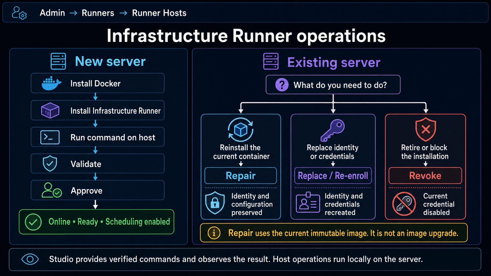
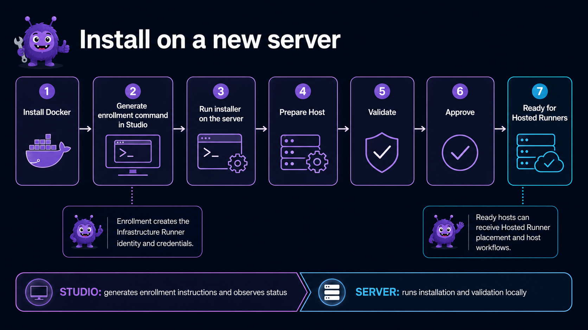
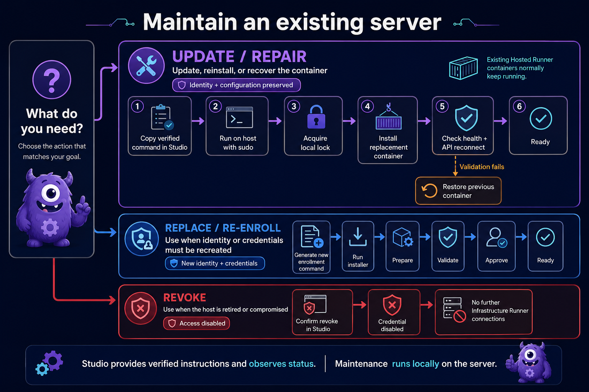

Use this page when adding a new Runner Host or maintaining an existing Infrastructure Runner. Studio provides verified commands and observes the result; maintenance runs locally on the server.

## Install on a new server

1. Prepare a Linux server with administrator access and install Docker.
2. In Studio, open **Admin → Runners → Runner Hosts**.
3. Select **Install Infrastructure Runner** for the target host and copy the generated installer command.
4. Connect to the server using SSH or its console, then run the copied command with `sudo`.
5. Return to **Admin → Runners → Runner Hosts** and select **Validate** for the host.
6. Correct any reported problems and validate again. When validation succeeds, select **Approve**.

The initial installer may authenticate with either the generated enrollment token or an Infrastructure Runner API key. Enrollment-token installs use the one-time token only to fetch the protected broker bootstrap configuration; the Runner still exchanges that token through the normal enrollment endpoint and persists its durable API key.

Approval enables Hosted Runner scheduling. Confirm that the host is **Online**, **Ready**, successfully validated, and shows the expected image digest. The server is then ready to host managed Runners. For the canonical host onboarding details, see **Add a Runner Host**.

Infrastructure capability profiles are issued by the enrollment flow; the installer and Repair command do not expose an operator capability override. `AUTOMATON_RUNNER_CAPABILITIES` is a generated runtime projection of that profile. When an existing installation reconnects or is repaired, the current canonical Infrastructure profile is written back before advertisement. The API still authorizes privileged host operations only when the connected Runner explicitly reports the capability and meets the required protocol version.

## Repair an existing Infrastructure Runner

Use **Repair** to reinstall or recover the Infrastructure Runner container without changing its identity or configuration. The current repair command reuses the container's installed immutable image; it does not select or deploy a newer image and does not provide update rollback.

It preserves the installation ID, API credential, `runner.json`, `installation-profile.json`, and other persisted configuration. The installer also refreshes the privileged Infrastructure Runner RabbitMQ settings from the API and stores them in protected host-only configuration so the durable command consumer is available after repair. These settings are never shown in Studio or passed to Hosted Runner containers.

1. Open **Admin → Runners → Runner Hosts**.
2. Select **Repair** for the server, review the installed image digest, and select **Copy command**.
3. Connect to the Runner Host and run the copied command with `sudo`.
4. Wait for the installer to finish, then return to Studio and refresh the details.
5. Confirm that the runner reconnected, is **Online** and **Ready**, passed health validation, retained its identity, and still shows the installed digest.

Existing Hosted Runner containers normally continue running. New provisioning and host workflows are temporarily unavailable while the Infrastructure Runner is disconnected. If repair fails, inspect the host and container logs before retrying.

## Replace and re-enroll

Use **Replace** only when the existing identity or credentials must no longer be retained—for example, when a credential was lost or exposed, the identity is corrupted, or persisted configuration is invalid.

1. Open **Admin → Runners → Runner Hosts**.
2. Select **Replace** for the server, read the warning, and confirm.
3. Copy the new enrollment command shown by Studio.
4. Run it with `sudo` on the server, then select **Validate** in Studio.
5. Select **Approve** after validation succeeds. Approval enables scheduling.

This creates a new installation identity and credentials. Do not use it for normal repair.

## Revoke an Infrastructure Runner

Use **Revoke** when a server is retired, lost, or compromised.

1. Disable Hosted Runner scheduling and confirm that no required Hosted Runners depend on the server.
2. Open **Admin → Runners → Runner Hosts**, select **Revoke**, review the warning, and confirm.

After revocation, the runner cannot reconnect or perform host operations. Revocation is not a repair operation.

## Which operation should I use?

| Situation | Operation |
| --- | --- |
| Install on a new server | Install Infrastructure Runner |
| Reinstall while keeping configuration | Repair |
| Recover a broken container deployment | Repair |
| Replace lost or compromised credentials | Replace |
| Create a new installation identity | Replace |
| Permanently retire or block the installation | Revoke |

## Troubleshooting

### Durable command development probe

The Runner includes `automaton-runner infrastructure-command-probe` for isolated
development checks. It requires `DOTNET_ENVIRONMENT=Development` and is not started
by the normal Runner service. Production Hosted Runner operations still use the
existing SignalR path.

The probe consumes one RabbitMQ command and acknowledges it only after the API
accepts the terminal Action result. It retrieves command-scoped secret grants and
posts results through the Runner's existing API-key credential. It is not started
by the normal Runner service, and production Hosted Runner operations still use
SignalR. Do not run it against a production broker or use it to retry a live host
operation.

### The command fails to download

Confirm HTTPS and DNS access to the Automaton API, copy a fresh command from Studio, and run it again.

### Checksum verification fails

Do not run a downloaded script manually. Delete the copy, copy a fresh verified command from Studio, and retry. If it fails again, verify that Studio and the API are running the current release.

### The Infrastructure Runner remains offline

On the server, check `docker ps -a` and `docker logs automaton-infrastructure-runner`. Confirm the container is running, its health check succeeds, it can reach the API, the persisted configuration directory is mounted, and its credential has not been revoked.

### The runner is online but not ready

Open **Admin → Runners → Runner Hosts**, run **Validate**, correct the reported failures, validate again, and approve the host if required.

### The image digest did not change

Repair intentionally reuses the installed immutable image. Do not assume **Repair** deploys a newer digest; use the separately supported image update process when one is available.

### Scheduling remains disabled

Confirm the runner is Online, Ready, approved, and successfully validated. Check available CPU, memory, and disk capacity.

### Repair fails

Inspect the container and installer logs. Do not repeatedly run Repair without identifying the failure. Use **Replace** only when preserving the existing identity and configuration is no longer appropriate.

## Important cautions

- Always copy the current command from Studio; do not reuse an old installer command.
- Run maintenance commands directly on the intended server.
- Never include API credentials or enrollment keys in logs, screenshots, or support messages.
- **Repair** preserves identity and configuration but reuses the installed image and has no remote rollback.
- **Replace** creates new identity and credentials.
- **Revoke** permanently blocks the current installation credential.
- Studio provides the command and observes the result; it does not remotely replace the Infrastructure Runner.
