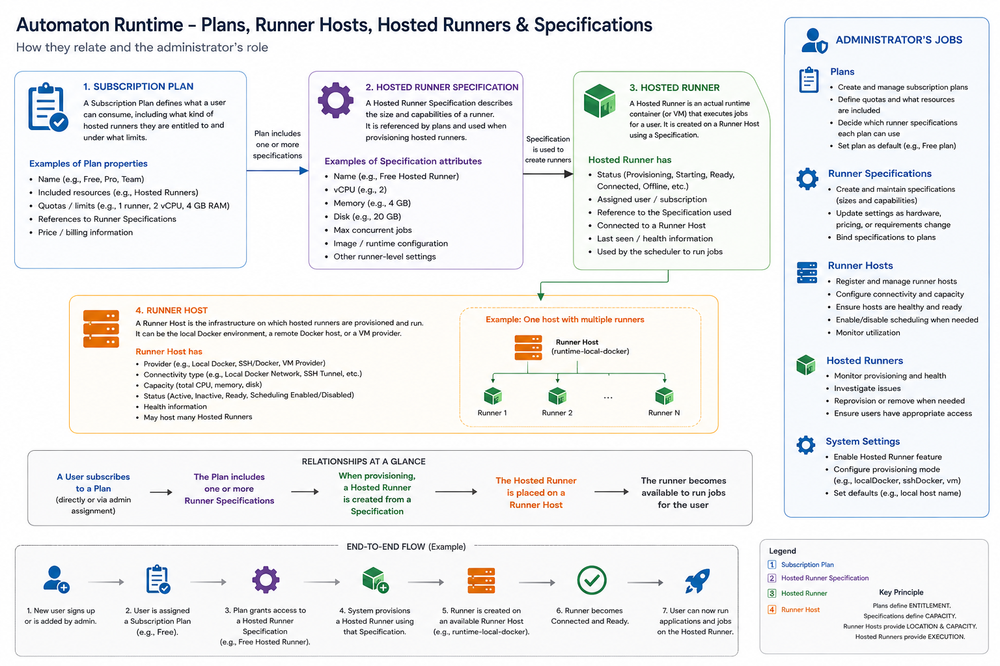

# Initial Platform Setup

## Goal

Prepare Automaton so users on an eligible subscription plan can receive managed runner containers.

## Setup readiness

The Hosted Runner model connects subscription plans, runner specifications, hosted runners, and runner hosts:

[](./assets/automaton-runtime-plans-runner-hosts-specifications.png)

Use this checklist before assigning a plan to a test user:

```text
Hosted Runner setup status

[ ] Active specification exists
[ ] Eligible subscription plan references it
[ ] Global provisioning is enabled
[ ] At least one host is scheduling-eligible
[ ] Host has enough free CPU, memory, and disk
[ ] Infrastructure Runner is online
```

The handbook is documentation rather than a live health monitor, so verify each item in the current admin screens. The authoritative values are the Specifications, Subscription Plans, Runner Hosts, and Runner Containers pages.

## Seeded starting configuration

A new installation normally contains this starting configuration:

- **Free** subscription plan;
- **Free Hosted Runner** specification;
- **Free** plan mapped to **Free Hosted Runner**;
- global hosted-runner provisioning enabled.

Verify these records before creating replacements. Continue with **Create a Specification** only when adding another runtime tier.

## Using the seeded Free configuration

For the first managed runner, use the seeded Free plan and Free Hosted Runner specification. Add a scheduling-eligible host, assign the Free plan to a test user, and provision the user’s Runner Container.

## Creating a new custom or paid configuration

1. Create an active Runner Specification.
2. Create or edit a Subscription Plan.
3. Enable Hosted Runner on that plan.
4. Assign the specification to the plan.
5. Add at least one Runner Host.
6. Validate and approve the host.
7. Enable host scheduling.
8. Ensure global hosted-runner provisioning is enabled.
9. Assign the plan to a test user.
10. Provision or trigger creation of the user’s Runner Container.

After the final step, verify that the container is running, connected, assigned to an eligible host, and using the expected active specification snapshot.
