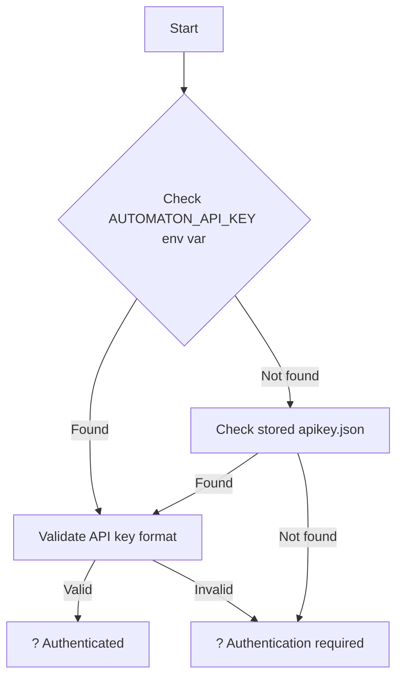

# Legacy JWT Authentication Removal - Complete ?

## Summary

Successfully removed all legacy JWT authentication from `Automaton.Runner.Console` project and replaced it with API Key authentication only.

## Changes Made

### 1. **Removed Files**
- ? `src\Automaton.Runner.Console\Services\ConsoleAuthenticationService.cs` - Deleted entirely

### 2. **Updated Services**

#### **ApiKeyAuthenticationService.cs**
- ? Added environment variable support for `AUTOMATON_API_KEY`
- ? Improved error messages with better emojis
- ? Added complete `IsValidApiKeyFormat()` method
- ? Enhanced `GetValidApiKeyAsync()` to check environment variables first

#### **FileStorageService.cs**
- ? Removed all JWT credential methods:
  - `SaveCredentialsAsync()`
  - `LoadCredentialsAsync()`
  - `DeleteCredentialsAsync()`
- ? Updated `IsLoggedIn()` to only check API key authentication
- ? Fixed async method warnings

#### **RunnerHostService.cs**
- ? Removed `ConsoleAuthenticationService` dependency
- ? Removed JWT authentication fallback logic
- ? Updated to use only API key authentication
- ? Improved error messages for authentication requirements
- ? Enhanced status display to show authentication source

#### **HubService.cs**
- ? Removed `ConsoleAuthenticationService` dependency
- ? Removed JWT token authentication logic
- ? Simplified to use only API key authentication via `X-API-Key` header

#### **FlowExecutionService.cs**
- ? Replaced `ConsoleAuthenticationService` with `ApiKeyAuthenticationService`
- ? Updated authentication setup to use API keys only
- ? Simplified authentication logic

### 3. **Updated Program.cs**
- ? Removed `login` command completely
- ? Removed `ConsoleAuthenticationService` registration
- ? Enhanced `status` command to show authentication source
- ? Cleaner command structure with only API key commands

### 4. **Updated Documentation**

#### **README.md**
- ? Removed all legacy JWT authentication references
- ? Removed deprecated `login` command documentation
- ? Removed migration guides and legacy warnings
- ? Streamlined to show API key authentication only
- ? Updated architecture section
- ? Simplified deployment examples
- ? Updated comparison table

## Environment Variable Support

The console runner now supports the `AUTOMATON_API_KEY` environment variable with priority:

1. **Environment Variable** (`AUTOMATON_API_KEY`) - Checked first
2. **Stored API Key** (`apikey.json`) - Fallback

## Commands Available

| Command | Description | Example |
|---------|-------------|---------|
| `auth` | Set API key | `automaton-runner auth --api-key ak_runner_xxx` |
| `register` | Register runner | `automaton-runner register --name "My-Runner"` |
| `run` | Start runner | `automaton-runner run --name "My-Runner"` |
| `status` | Show status | `automaton-runner status` |

## File Storage Structure

```
%APPDATA%\AutomatonRunner\  (Windows)
~/.config/AutomatonRunner/  (Linux/macOS)
??? apikey.json      ? API key credentials
??? runner.json      ? Runner registration info
```

## Authentication Flow



## Testing

The console runner builds successfully with no compilation errors:

```bash
dotnet build src\Automaton.Runner.Console\Automaton.Runner.Console.csproj
# ? Build succeeded
```

## Production Ready Features

- ? **Cross-platform**: Windows, Linux, macOS
- ? **Environment variables**: `AUTOMATON_API_KEY` support
- ? **Docker ready**: Containerized deployment
- ? **CI/CD friendly**: Scriptable authentication
- ? **Secure**: API key only authentication
- ? **Clean architecture**: No legacy code

## Migration Impact

**For existing users:**
- Old `login` command removed - use `auth` command instead
- JWT tokens no longer supported - create API keys in Automaton Studio
- Environment variable `AUTOMATON_API_KEY` provides seamless automation

**For new deployments:**
- Simpler setup with API key only
- Better automation support
- Cleaner command structure

---

## ? **Completion Status: DONE**

The legacy JWT authentication has been completely removed from `Automaton.Runner.Console`. The project now uses **API Key authentication exclusively**, providing better security, easier automation, and cleaner architecture.