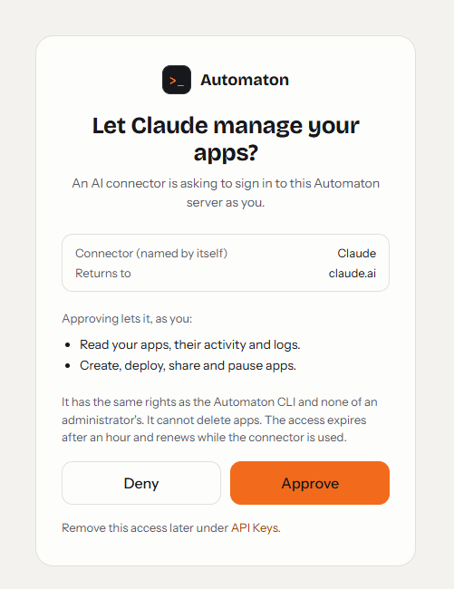
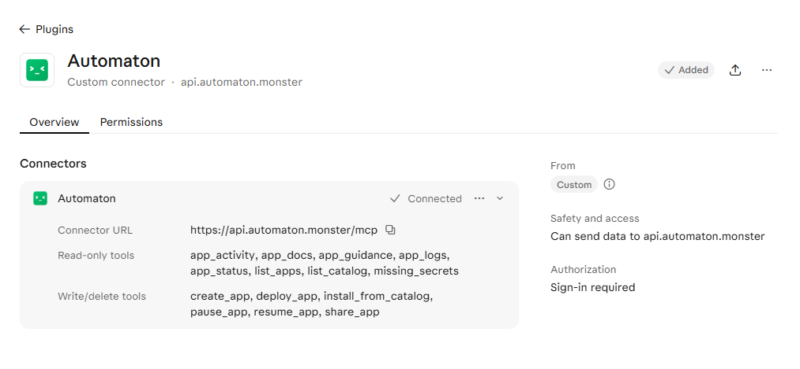

# Work with AI

With Automaton you care about the app you are making, not about servers, hosting or publishing. You say what you want and judge the result. Your AI does the hard work. Automaton runs the app, shares it and keeps it safe.

## The loop

1. **Describe it.** "An app that checks my website every 5 minutes and emails me when it is down."
2. **Your AI builds and deploys it.** It writes the code, runs it on your server and checks that it works before it tells you.
3. **You look at it in Studio.** Open the app, try it, read what it did.
4. **You say what to change.** "Make the email shorter." "Add a page with the last 24 hours."
5. **Repeat until you are happy.**

You never write a Dockerfile, open a port, buy a certificate or set up a domain for an app.

## Set up once

You need an Automaton server (your AI can [install it](./install#for-ai-agents)) and an AI that can run commands on your computer, such as [Claude Code](https://claude.com/claude-code).

1. Install the CLI. Linux or macOS:

   ```bash
   curl -fsSL https://github.com/rzvdaniel/automaton/releases/latest/download/install.sh | sh
   ```

   Windows (PowerShell): `irm https://github.com/rzvdaniel/automaton/releases/latest/download/install.ps1 | iex`

2. Sign in to your server, once per computer: `automaton login --server https://api.yourdomain.com`
3. Open an empty folder in your AI and start.

## Your first prompt

> Build me an Automaton app that checks https://example.com every 5 minutes and emails me when it is down. Use the Automaton CLI, deploy it, check that it runs, then tell me where to see it in Studio.

Your AI creates the app with `automaton new`. That also writes `AGENTS.md`: the instructions that teach your AI how to build, check and deploy an Automaton app, so you never explain it again.

## Give your AI these docs

Every page here has a **Copy for AI** button that copies its Markdown. To hand your AI the whole set, point it at [llms.txt](https://automaton.monster/llms.txt) (an index) or [llms-full.txt](https://automaton.monster/llms-full.txt) (every page in one file).

## Check it in Studio

Open Studio, then **Apps** and your app:

- **Overview:** is it running, which version, how much disk it uses, and anything that needs you.
- **Activity:** every run and deploy, and what went wrong. On a failed run or deploy, **Copy for AI** copies the app, version, error and last 40 log lines as text (names of secrets, never their values) for you to paste into your AI.
- **Open Application:** the app itself, if it has pages.

Something not right? Tell your AI what you see, in your own words. It reads the logs, fixes the code and deploys again.

## Start from what exists

Before asking for something big, look in **Catalog**. A blog, analytics, link checker or log viewer may already be there, tested and one click away. Install it, then ask your AI to adapt it: "Fork the link checker and email me a weekly summary."

## Share it when it is ready

Every app starts private. With **Share** (or by asking your AI) you choose:

| Who can open it | For |
|---|---|
| Only you | trying things |
| People I choose | a few people on your server |
| Everyone on this server | your team or family |
| Public | anyone with the link |

To show it off, publish it in your own app store with a cover and a description.

## Day two

Studio **Home** tells you what needs you: an update, a failed run, a permission to approve. Hand it to your AI: "The checker failed at 17:13, look at the logs and fix it." When a new Automaton version comes out, update from **Server** in one click; apps keep running.

### Let Claude read and manage your apps

Your server has an MCP endpoint at `/mcp`. Studio shows this server's address and the command to copy under **Settings, Agents and keys, Connect your AI**. In Claude Code, add it without a key:

```bash
claude mcp add --transport http automaton https://api.your-domain.com/mcp
```

Claude Code opens your server's sign-in; press Approve in Studio and it is connected. No key passes through your clipboard, chat or terminal history. For CI and headless machines, where nobody can approve, use an API key instead: open "Use an API key instead" in the panel (or, without Studio, run `automaton keys create --name mcp --email you@example.com --out mcp-key < password-file`, which writes a key to an owner-only file) and add it as a header:

```bash
claude mcp add --transport http automaton https://api.your-domain.com/mcp --header "Authorization: Bearer <your API key>"
```

Claude can then list your apps (each with its full https link, private apps included: `list_apps`, `app_status`, `share_app` and `deploy_app` return it) and read one app's status (after a failed deploy it says whether the previous version is still serving), activity, logs (the last 500 lines at most) and README. It can also create an app (`create_app`), deploy it from files it writes (`deploy_app`, up to 50 MB; an app without a Runner gets your only online Management Runner, as `automaton deploy` does, and with none or several Claude is told to choose one in Studio; waits until the app is Running or returns the failure with the latest log lines), choose who can open it (`share_app`: only you, people, team, server or internet), pause and resume it, search and install from the catalog, and read the guidance for building Automaton apps (`app_guidance`). `missing_secrets` names the secrets an app still needs and links to Studio to fill them: secret values never pass through MCP. Claude can change only the apps your key can change, and it cannot delete apps. Without an approval or a key, or with a wrong one, the endpoint answers 401.

#### Add it to Claude on the web or your phone

In Claude, open Settings, Plugins, Browse plugins, Add connector, and under "Or add a custom connector by URL" enter a name and `https://api.your-domain.com/mcp`; keep the detected sign-in settings and press Add, then Connect. Claude sends you to your server's sign-in page; sign in, check the connector's name and where it returns to, and press Approve. Claude then has the same tools, as you and with the rights the CLI has: no administration and no deleting apps. The access lasts an hour and renews while Claude uses it. Each connection appears under **Settings, API Keys** as "Claude connector"; delete it there and the next call fails. Your server must be reachable from the internet over https for Claude to reach it.





## Prompts that work well

- "Deploy it and check it works before you tell me it's done."
- "It failed at 17:13. Read the logs and fix it."
- "Add a setting for the address to check, so I can change it in Studio."
- "Keep the API key as a secret, not in the code."
- "Let my team open it." / "Publish it in the store."

## Good to know

- **Your apps, your server.** Apps and their data stay on machines you choose. The cost is the server you rent.
- **Secrets stay out of the chat.** You type keys and passwords in Studio or the CLI; your AI only names them.
- **You approve what apps may do.** Sending email or reading the server needs an administrator's approval in Studio.
- **Data survives new versions** when the app keeps it in its data folder (`AUTOMATON_APP_DATA_DIR`); everything else is replaced on each deploy. Your AI knows this from `AGENTS.md`.
- **A broken version is caught.** If a new version does not answer its health check, the deploy fails and your AI sees why in the logs.

Next: [Build an app](./build-an-app) for what your AI writes, [CLI recipes](./cli) for the commands your AI runs, and the command list in [CLI recipes](./cli#all-commands).
